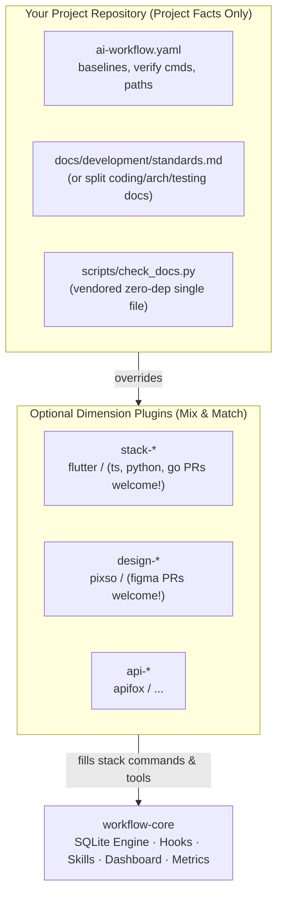

# SpecLock

**English** | [简体中文](README.zh-CN.md)

[](LICENSE)
[](#architecture)
[](#installation)
[](docs/development/release-0.21.0.md)

**Lock your specs before your agent writes a single line of code. Hard-enforced AI engineering workflow for Claude Code, Codex, and Cursor.**

> **Superpowers teaches AI discipline with prompts. SpecLock enforces it with Hooks + a SQLite state machine + SHA-256 baseline receipts.**
> Your agent literally *cannot* edit code before reading your required standards in full, *cannot* bypass tier approval, and *cannot* claim tests passed without running real commands against the current workspace snapshot.

---

## Why SpecLock?

Prompt-only skill packs work great on short sessions — until context grows long and the agent silently skips reading your architecture rules, edits code before you approve scope, or claims *"tests pass"* after running nothing.

SpecLock turns engineering discipline into **deterministic, auditable code-level guardrails** with **zero third-party dependencies** (pure Python standard library + SQLite):

- **Anti-Skip Baseline Receipts (SHA-256)**: Before code edits unlock, the agent must read every `baseline.required` / `baseline.scoped` doc in full; truncated reads (`BASELINE_BATCH_LIMIT`) or modified files invalidate the receipt automatically.
- **Human Tiering & Proposal Gate**: Every task is explicitly tiered by risk (**Light / Standard / Full**). Full-tier work (auth, security, migrations, breaking contracts) requires separate proposal & design approval bound to a `control_digest`.
- **Real Verification Snapshots**: `run` executes real command `argv` arrays (no shell injection), captures exit codes, and binds results to a cryptographic Git workspace snapshot — any subsequent edit marks stale evidence `stale`.
- **Dual-Axis Review (`Spec` + `Standards`)**: Every tier undergoes structured Spec compliance and Standards review with stable finding IDs that cannot be silently dropped on retry.
- **Streamlined 5-Step CLI Loop**: `prepare` → `begin` → `finish-step --finish-implementation` → `run` → `review` — auto-derives baselines & checks from `ai-workflow.yaml` and returns inline `progress` projections, keeping friction low without weakening a single gate.
- **Self-Contained Doc Checks & Archiving**: Vendor a zero-dependency single-file `scripts/check_docs.py` directly into any repo (no local symlinks, no plugin cache dependency, works in any CI/sandbox), and archive completed changes with `/workflow-core:archive`.

---

## SpecLock vs. Superpowers

[Superpowers](https://github.com/obra/superpowers) is an awesome prompt-based engineering methodology pack. **SpecLock is not a hostile replacement — it is a stronger governance layer designed for real team repositories**, and works great *alongside* Superpowers (in fact, our Flutter preset bundles `superpowers` directly).

| Dimension | Superpowers (Prompt Methodology) | SpecLock (`v0.21.0`) |
| --- | --- | --- |
| **Enforcement Mechanism** | Soft prompt discipline — agents can drift, skip reading specs, or fake verification on long threads | **Hooks + SQLite State Machine + SHA-256 Receipts** — blocks writes until baselines are read, tier is confirmed, and real checks match the current snapshot |
| **Risk Tiering & TDD** | Strict TDD everywhere (can feel rigid on UI, copy, or doc tasks) | **3 Risk Tiers (Light / Standard / Full)** + pragmatic TDD-first (opt-out requires recorded reason & alternative validation) |
| **Team & External Workflow** | Single-repo coding methodology | End-to-end delivery: PRD breakdown, 7-field lean task cards with auto write-back, `[x]` vs. non-terminal status hard-check, design/API plugins, change archiving |
| **Portability & Efficiency** | Zero-config & fast | **Zero-dependency single-file doc checker** (`vendor_check_docs.py`) for any CI/sandbox + streamlined 5-step CLI (`prepare` / `begin`) |
| **Observability & Evolution** | Chat transcripts / static notes | Built-in read-only **Dashboard**, round/attempt audit trail, cross-session **Handoff**, and **Metrics** rule-effectiveness analytics |

**Best-of-both-worlds setup**: Run SpecLock as your repository's hard guardrail backbone, and invoke Superpowers' `brainstorming` or `systematic-debugging` whenever you need open-ended architecture exploration or deep root-cause debugging.

---

## 30-Second Quick Try (Zero Risk, Sandbox Included)

Try the self-contained doc checker and the full 5-step `prepare → begin → finish-step → run → review` engine locally without touching your own repositories:

```bash
git clone https://github.com/lvzhiyi/speclock.git
cd speclock

# 1. Run doc & card consistency checks on the bundled sandbox project
python3 examples/workflow-sandbox/scripts/check.py docs

# 2. Run the end-to-end streamlined engine CLI tests (verifies hard gates + baseline SHA-256)
python3 -m unittest discover -s plugins/workflow-core/scripts/tests_engine -p 'test_cli.py'
```

---

## Architecture

SpecLock is **100% stack-agnostic** at its core (`workflow-core`) and cleanly separates project facts from reusable plugins:



### Streamlined 5-Step Task Lifecycle

```bash
# 1. Create task (auto-derives baselines & check plan from ai-workflow.yaml), bind session & request tier
we prepare --task T1 --tier 标准 --acceptance "A1" --details-json '{...}' --executor agent --session S1 --request-tier

# 2. After human confirms tier (and approves proposal on Full tier):
#    Atomically output full baseline docs, record SHA-256 receipts, start implementing & record TDD
we begin --task T1 --executor agent --session S1 --tdd-json '{"adopted":true}'

# 3. Finish implementation step(s) (inline progress projection returned automatically)
we finish-step --task T1 --version V --step s1 --summary "Implemented fix" --finish-implementation

# 4. Run real verification commands against Git snapshot + submit dual-axis review
we run --task T1 --version V2
we review --task T1 --version V3 --file-json '{...}'
```

All granular atomic commands (`create`, `bind-executor`, `read-baseline`, `start`, `record-tdd`, `finish-implementation`, `repair`, `return-task`, `sync-review-card`) remain fully supported for batched reads, idempotent retries, and recovery. See [Engine Protocol v2](docs/development/workflow-engine.md) for full specs.

---

## Installation

### Claude Code

```bash
claude plugin marketplace add lvzhiyi/speclock
claude plugin install workflow-core@speclock
```

For Flutter + Pixso + Apifox projects (optional all-in-one preset):
```bash
claude plugin marketplace add flutter/agent-plugins
claude plugin install preset-flutter-pixso-apifox@speclock
```

### Codex

```bash
codex plugin marketplace add lvzhiyi/speclock --ref main
codex plugin add workflow-core@speclock
```

Open your project, start a new session, trust hooks in `/hooks` (or **Settings → Hooks**), and run `$workflow-core:init`.

### Cursor

`workflow-core` ships native Cursor plugin metadata (`.cursor-plugin/plugin.json`) and hooks (`hooks/cursor.json`). Add this repo as a marketplace or load `plugins/workflow-core` locally. See [Cursor Adapter Guide](docs/development/cursor-adapter.md) for details.

---

## Daily Skills Cheat Sheet

| Goal | Claude Code | Codex |
| --- | --- | --- |
| Initialize `ai-workflow.yaml` & lean doc skeleton (`standards.md` ≤200 lines) | `/workflow-core:init` | `$workflow-core:init` |
| Start or resume any task through the guarded workflow | `/workflow-core:workflow` | `$workflow-core:workflow` |
| Break down a PRD into lean 7-field module task cards | `/workflow-core:prd-breakdown` | `$workflow-core:prd-breakdown` |
| Run Spec + Standards dual-axis review & auto-update task card | `/workflow-core:review` | `$workflow-core:review` |
| Archive merged change folders & verify zero broken links | `/workflow-core:archive` | `$workflow-core:archive` |
| Save or restore cross-session handoff snapshots | `/workflow-core:handoff` | `$workflow-core:handoff` |
| Open read-only task progress & evidence dashboard | `/workflow-core:dashboard` | `$workflow-core:dashboard` |
| Inspect rule effectiveness & trigger metrics | `/workflow-core:metrics` | `$workflow-core:metrics` |

### Vendor a Zero-Dependency Doc Checker Into Any Repo

Keep CI and sandboxed agents completely independent of local plugin paths:

```bash
python3 plugins/workflow-core/scripts/vendor_check_docs.py --output /path/to/your-repo/scripts/check_docs.py
python3 /path/to/your-repo/scripts/check_docs.py --root /path/to/your-repo --check-config
```

---

## Built-in Plugins & Community Roadmap

| Plugin | Dimension | Status |
| --- | --- | --- |
| `workflow-core` | Core engine, hooks, skills, dashboard, metrics, archiving | Production (`v0.21.0`, stack-agnostic) |
| `stack-flutter` | Flutter checks, Stop hook analyzer, platform rules | Included |
| `design-pixso` | Pixso MCP integration & visual node verification | Included |
| `api-apifox` | Apifox contract queries & write-authorization guardrails | Included |
| `preset-flutter-pixso-apifox` | Bundle for Flutter + Pixso + Apifox (+ Context7 & Superpowers) | Included |

**Contributions Welcome!** Great first plugins to add:
- `stack-typescript` / `stack-nextjs` (`tsc --noEmit` + `eslint` Stop hook)
- `stack-python` (`ruff` + `pytest` Stop hook)
- `stack-go` (`go vet` + `go test`)
- `design-figma` (Figma MCP node verification)

---

## Documentation & Release Notes

- [中文完整文档（Full Chinese Documentation）](README.zh-CN.md)
- [Engine Protocol v2](docs/development/workflow-engine.md)
- [Cursor Adapter Guide](docs/development/cursor-adapter.md)
- [Release Notes: v0.21.0](docs/development/release-0.21.0.md)
- [License (MIT)](LICENSE)
