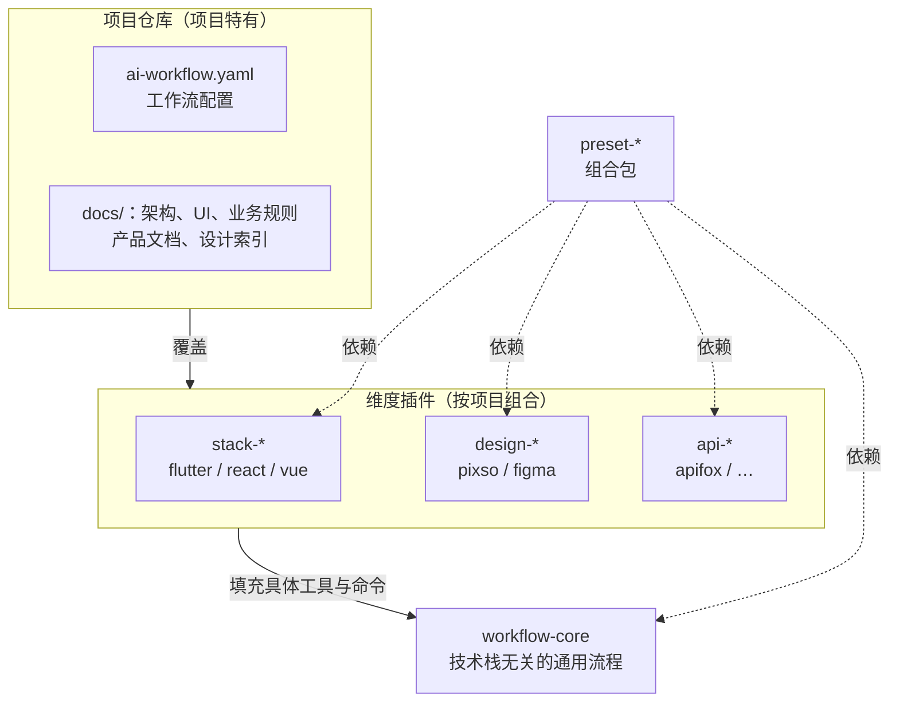
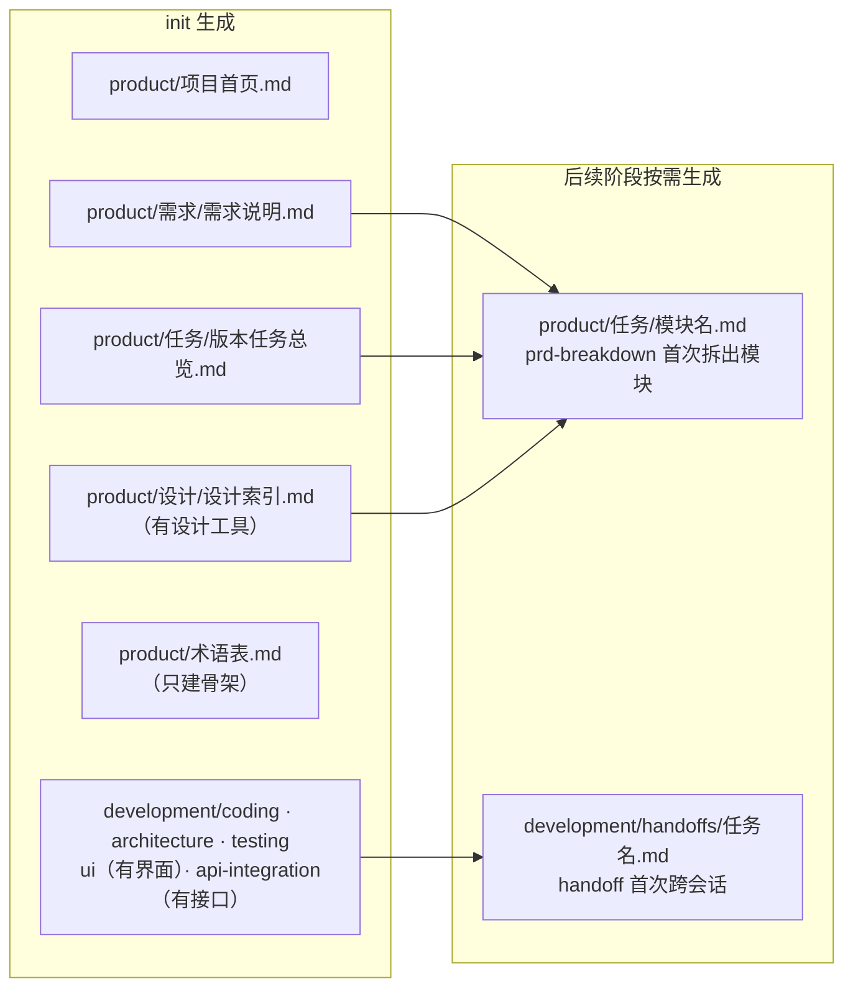

# ai-dev-workflow

面向 Codex 和 Claude Code 的 AI 协作开发工作流插件集。把“需求接收与拆解 → 任务就绪检查 → 实施 → 验证 → Agent 双轴评审 → 人工验收/交付”的任务级流程沉淀成可复用的技能，按**通用流程 / 技术栈 / 设计工具 / 接口工具**四个维度拆成插件，各项目按需组合安装。

> 提炼自 `course_student_app`（Flutter + Pixso + Apifox）的实际工作流。

## 特点

**让 AI 开发有流程、看得见、管得住，而且越用越准。**

| 特点 | 怎么做到 | 入口 |
| --- | --- | --- |
| **数据驱动进化** | 自动积累技能触发率、评审命中、钩子拦截和「待验证」比例，算出哪些规则有效、哪些该改、哪些可以删。只给候选，去留由人决定，安全类规则受保护 | `/workflow-core:metrics` |
| **任务执行可观测** | 展示任务轮次、尝试、todo、有效证据和活动新鲜度；Trace 整合到只读看板 | `/workflow-core:dashboard` |
| **流程防护栏** | 始终启用的插件级门禁，引擎判据与宿主受支持工具路径协作；Claude 支持版本绑定确认回调，Codex 暂用人工终端兜底，不承诺抗程序代答或全写路径覆盖 | `workflow` |
| **全程可控** | 按风险分轻量、标准、完整三档，流程成本和风险对齐；完整档先批准再分段实施；提交、发布、写入外部系统都要明确授权 | `tiering`、`implement` |
| **结果可检测** | 三档规定验证与 Agent Spec + Standards 两轴均通过才为评审通过；人工验收/交付独立记录 | `verify`、`review`、`deliver` |
| **扩展到任意技术栈** | 通用流程与技术栈无关；技术栈、设计工具、接口工具各是独立维度，加一个 `stack-*` 插件就能接入新技术栈。目前内置 Flutter + Pixso + Apifox | [扩展指南](#扩展新增阶段技术栈或工具) |
| **两步接入** | 装插件后运行 `init`，自动探测项目并生成结构化配置和文档骨架，只问探测不出来的项 | `/workflow-core:init` |
| **中断可恢复** | 进度快照写进仓库，换会话、换人、换 Agent 都能按固定步骤接着做 | `handoff` |
| **规则不打架** | 流程在插件、事实在项目，同一条规则只保留一处；skill 按需加载，不占常驻上下文 | [规则优先级](#插件一览) |
| **数据留在本机** | 轨迹和度量只写本机。度量只存枚举、计数和规则名 | Codex 的 `$CODEX_HOME`（默认 `~/.codex/`）或 `~/.claude/` |

### 任务执行与证据一目了然

用 `/workflow-core:dashboard`（Codex 用 `$workflow-core:dashboard`）查询任务级只读看板，显式 `on` 才启动服务，按实际返回地址查看。Trace 已整合至此入口，旧 `trace` 技能仅作迁移提示。看板显示任务局部流程与当前轮次证据，不批准任务、不写流程状态；活动缺失仅表示未知，不推测阻塞。确认和观测已有自动化集成测试，真实双宿主会话尚待实测，不以文档约定冒充宿主端到端实测。

## 目录

- [特点](#特点)
- [插件一览](#插件一览)
- [工作流全景](#工作流全景)
- [各阶段说明](#各阶段说明)
- [安装](#安装)
- [在项目中使用](#在项目中使用)
- [扩展：新增阶段、技术栈或工具](#扩展新增阶段技术栈或工具)

## 插件一览

| 插件 | 维度 | 内容 |
| --- | --- | --- |
| `workflow-core` | 通用流程 | 项目接入初始化（`init`）、文档规范检查脚本、总入口、三档分级、PRD 拆解、任务就绪检查、分段实施、接口契约、第三方文档、验证与失败分类、双轴代码评审（`review`）、统一交付、中断交接、任务级只读看板与整合执行观测（`dashboard`，旧 `trace` 仅迁移提示）、流程度量报告（`metrics`） |
| `stack-flutter` | 技术栈 | 版本核对、默认检查脚本、Stop 钩子兜底静态分析、平台验证口径、评审清单、生成代码、常见坑 |
| `design-pixso` | 设计工具 | Pixso MCP 配置、节点定位、读取层级、视觉核对 |
| `api-apifox` | 接口工具 | Apifox CLI/MCP 接入、操作授权边界、与后端不一致时的处理 |
| `preset-flutter-pixso-apifox` | Claude Code 组合包 | 依赖以上四个 + 官方 `context7`、`superpowers`、`dart-flutter`（Dart and Flutter），一次装齐 |



**规则优先级**：用户本次指令 > 项目配置与 `docs/` > 维度插件惯例 > `workflow-core` 通用流程 > 其他技能的通用建议。

**分层原则**：每条规则问一句“换一个同技术栈的项目还成立吗”。不成立的（默认验证平台、具体接口项目、架构分层选型）留在项目里，不进插件。

## 工作流全景

接入配置（`init`）按项目进行；日常以任务为单位推进，不使用全局八步状态：

1. **需求接收与拆解**（`prd-breakdown`）：记录目标、范围/非目标、验收、来源与依赖；小任务可在会话/Issue 原位简记，不强制 PRD。
2. **任务就绪检查**（`kickoff`、`tiering`）：核对缺项、人工定档与范围、计划和适用基线；未就绪可调查，不可实施。
3. **实施**（`implement`）：成功完整读取必读基线后按 todos 推进；TDD 优先非强制，不采用按任务/步骤写原因及替代验证，不增加豁免审批。
4. **验证**（`verify`）：沿用 `verify.light/standard/full` 与平台配置，逐项真实执行；遗漏、失败、异常或失效都不能写通过。
5. **Agent 双轴评审**（`review`）：所有档位都做 Spec + Standards，规定验证全部通过且两轴通过、证据有效后为“评审通过”（`review_passed`），这是 Agent 终态。
6. **Agent 总结与人工交接**（`deliver`）：总结范围、证据、剩余和下一步；后续人工验收/交付另行记录，不能自动宣称产品完成。

`handoff` 可在任何阶段保存和恢复；Dashboard 是任务级只读观测与 Trace 整合入口，不是控制台。只授权需求整理时不会自动进入产品实施。

## 各阶段说明

### 三档、计划与批准

- **轻量**：文案、文档、局部样式、预期明确的局部小 Bug；简要记录和至少一项 todo，不强制独立计划。
- **标准**：复用架构、边界明确的局部功能；原位 3～5 步短计划，无额外方案审批。
- **完整**：跨模块、安全/权限、迁移、破坏性或外部契约变化、关键规则不明等；方案包含目标、范围/非目标、影响、风险/回滚、验收、todos，另行人工批准。

三档均须人工确认档位和实施范围，轻量不豁免基线、验证或任一评审轴。批准绑定任务当前轮次与控制摘要：换会话/Agent、原范围修复重试、todo 细化、措辞调整不重复审批；档位、范围、验收或实质方案变化重新确认，完整档重新批准。新 Agent 重读基线但不重批有效方案。摘要只能检测差异，不能把每个字节变化都当实质变化；实际控制字段保守失效时明确核对，不伪造批准。

### 需求、来源与人工完成

需求接收并入 `prd-breakdown`，同一事实只维护一处：业务规则在需求说明，设计节点在设计索引，任务进度与证据在模块卡，技术 todos 在规格 tasks。缺项写影响、负责人、恢复条件和来源，只暂停依赖部分。任务卡分别记录 Agent 评审与人工验收/交付；不能因评审通过、PR 合并或技术 todos 完成勾选人工完成。

### 基线、实施与验证

配置适用基线必须成功完整读取，记录内容版本、覆盖范围、字节、执行者与轮次；缺失、失败、截断或未处理冲突不能通过，不无限递归引用。文档读取回执不是理解证明，修改前测试基线也不能代替必读规范。实施步骤完成仅进入待验证。

验证保留真实命令、环境、退出码与输入快照；失败区分本次回归、环境问题、既有失败、原因待定位、需求不明、超范围和无进展。原范围可修复重试，不删断言、不降门槛；无新证据/假设时停止重复。输入变化使受影响下游证据失效；CI、Mock、真实联调、设备操作与未覆盖平台分别说明。

### 双轴评审与总结

Spec 核对目标、范围、验收及需求来源；Standards 核对项目规范、术语、技术栈清单、性能和可维护性约束。轻量无规格文件时仍按已确认预期做 Spec，不跳轴。必修问题保持稳定 ID，重试显式关闭，不能删除旧问题逃避失败。评审通过不是无缺陷证明。

`deliver` 先报告实际状态与版本绑定证据，再给人工验收/交付的剩余条件，不再使用“自测完成”终态，也不自动完成产品。人工确认人、时间、范围/版本、结论和来源独立记录；提交、推送、合并、发布继续各自授权。

### 始终启用的插件级防护栏

没有提醒/严格模式选择，也没有 engine 开关。引擎统一状态与规则，宿主在受支持工具路径执行门禁。原生确认回调适配仍在进行；宿主能力不足或脚本缺失必须说明，不静默降级，不把模拟测试当宿主实测。人工确认只是流程证据，TTY、actor、普通状态更新均不是可信签署；本期不防程序代答、同账号篡改或覆盖全部写入路径，不是安全沙箱。

新任务通过实际引擎 CLI 的 `create --details` 登记 v2；旧任务仅经用户明确选择 `adopt-protocol`，保留旧历史但旧证据不继承。所有修改使用最新整数 `version` 与唯一 `request`，不要手写数据库或编造 mark-pass 命令。继续与总结前查询：

```bash
python3 "${CLAUDE_PLUGIN_ROOT}/scripts/workflow_engine_cli.py" --root "项目根" --db "项目根外的状态库" status --task "任务ID"
```

`${CLAUDE_PLUGIN_ROOT}` 为安装插件根，未替换时按技能实际路径定位；其他命令先看实际 `--help`。协议见 [任务级引擎说明](docs/development/workflow-engine.md)，执行规则见 [workflow 技能](plugins/workflow-core/skills/workflow/SKILL.md)。

### 轮次、尝试与中断恢复

任务下保留执行轮次、阶段尝试和版本绑定证据；每轮有主执行者，协作者继承绑定授权并做版本检查。续做复用有效轮次，失败重试新增尝试，人工退回或实质返工保留历史并重新授权；取消不能自动恢复。

`handoff` 原位保存任务/轮次/尝试、授权与来源链接、基线读取、有效/失效证据、失败、未完 todo 和恢复条件。恢复时查询引擎、核对 Git/进程/环境，新 Agent 重读基线并复验受影响项；不自动 reset/clean/stash。业务阶段与活动分离，无退出或心跳证据只显示活动未知。

## 安装

### Codex

在任意目录执行。Codex 会从 GitHub 的 `main` 分支拉取插件目录。

```bash
codex plugin marketplace add lvzhiyi/randian-ai-workflow-native --ref main
codex plugin add workflow-core@ai-dev-workflow
# Flutter + Pixso + Apifox 项目再装以下三个，可按需选装
codex plugin add stack-flutter@ai-dev-workflow
codex plugin add design-pixso@ai-dev-workflow
codex plugin add api-apifox@ai-dev-workflow
```

如果之前注册过同名的本地源，先用 `codex plugin marketplace list` 确认，再执行 `codex plugin marketplace remove ai-dev-workflow`，然后运行上面的安装命令。

Codex 共用此仓库的 marketplace，四个插件各自提供 `.codex-plugin/plugin.json`。按需单独配置 Context7、Superpowers 和官方 Dart and Flutter，Apifox CLI 也需单独安装登录。Pixso MCP 已随 `design-pixso` 声明，首次使用按提示授权。

打开目标项目并新建 Codex 会话。在 CLI 的 `/hooks` 或桌面端的 **Settings → Hooks** 检查并信任要启用的钩子。首次接入时用 `$workflow-core:init` 生成 `ai-workflow.yaml` 和文档骨架，已有配置的项目直接用 `$workflow-core:workflow`。下文 Claude Code 的技能命令可在 Codex 中使用同名的 `$插件名:技能名`。

- **宿主门禁**按实际支持的工具路径执行任务规则；Claude 支持版本绑定确认回调，Codex 暂用人工终端兜底，不能把旧交付提醒当成完整门禁，也不能宣称 Shell 或续写路径全覆盖。Flutter Stop 静态分析属于额外检查，不替代任务级验证与评审。
- **任务观测**使用 `$workflow-core:dashboard`，Trace 整合在任务详情中；旧 `trace` 入口只提示迁移。宿主事件能力以实际适配结果为准，不保证每种工具都有事件。
- **流程度量**使用 `$workflow-core:metrics` 汇总评审、交付和 Flutter 拦截记录。技能触发率及据此推导的规则删除候选目前仅由 Claude Code 会话数据提供。

看板服务需要访问本机回环地址并写入本机运行目录；权限或沙盒限制按 [dashboard 技能](plugins/workflow-core/skills/dashboard/SKILL.md) 报告。流程度量是辅助统计，不替代任务证据。

参见 [OpenAI 插件打包文档](https://developers.openai.com/plugins/build/plugins) 和 [Codex 钩子文档](https://learn.chatgpt.com/docs/hooks)。

### Claude Code

#### 1. 添加 marketplace

```bash
# 团队成员：从 GitHub 仓库添加
claude plugin marketplace add lvzhiyi/randian-ai-workflow-native
```

#### 2. 安装插件

**先选安装范围**：插件只在启用它的范围内生效。

| 范围 | 参数 | 写入位置 | 生效范围 | 适合 |
| --- | --- | --- | --- | --- |
| user | 默认（不加） | `~/.claude/settings.json` | 你本机所有项目 | `workflow-core`：和技术栈无关，装一次处处可用 |
| project | `--scope project` | 项目 `.claude/settings.json`（进 git） | 该项目，团队共享 | 技术栈、设计、接口插件和 preset |
| local | `--scope local` | 项目 `.claude/settings.local.json`（不进 git） | 该项目，只有你自己 | 个人试用 |

> 常见坑：用 `--scope local` 装过后，换到别的项目会看到插件被列出但显示 `disabled`，也没有 `/workflow-core:init`。marketplace 是用户级的所以能列出，启用只记录在原项目里。需要的话在新项目再装一次，或把 `workflow-core` 装成 user 范围。

推荐组合：`workflow-core` 装 user 范围；进入新项目后先跑 `/workflow-core:init`，它会按技术栈建议该装哪些维度插件。

一次装齐（Flutter + Pixso + Apifox 项目）：

```bash
claude plugin install preset-flutter-pixso-apifox@ai-dev-workflow
```

或按维度单独安装：

```bash
claude plugin install workflow-core@ai-dev-workflow
```

`preset` 还依赖三个外部插件，本仓库 `marketplace.json` 已把它们所在的 marketplace 加入跨 marketplace 白名单：

| 插件 | 所在 marketplace | 本机需要 |
| --- | --- | --- |
| `context7`、`superpowers` | `claude-plugins-official` | 内置，无需操作 |
| `dart-flutter`（官方 Dart and Flutter：Flutter/Dart 技能 + Dart MCP server） | `dart-flutter`（`flutter/agent-plugins`） | **安装 preset 前先添加**，见下 |

```bash
claude plugin marketplace add flutter/agent-plugins
```

依赖解析不会自动添加 marketplace：没添加时 preset 能装上，但会提示 `dart-flutter` 未安装且 preset 显示加载失败。preset 本身没有内容，**不影响** workflow-core、stack-flutter 等插件正常工作；补上 marketplace 后重新执行 `install` 即可。用项目 `.claude/settings.json` 分发时（见下文）已包含这个 marketplace，团队成员不用手动添加。

> `dart-flutter` 也出现在内置的 Anthropic 插件目录里，但 CLI 无法按名称从内置目录解析它，所以依赖指向它自己的 marketplace。

### 额外前置

- **Apifox CLI 与官方技能**：按 [Apifox CLI 安装指南](https://apifox.com/apifox-cli-installation-guide.md) 安装登录，令牌只留在本机。
- **Pixso MCP**：`design-pixso` 已内置 `https://pixso.cn/mcp`，首次调用按提示授权。用户级已配过同名 Pixso MCP 的，删掉一处避免工具重复。
- **OpenSpec**（如项目使用）：按项目说明安装。

## 在项目中使用

### 1. 初始化：工作流配置 + 文档骨架（每个项目一次）

在项目里执行：

```
/workflow-core:init
```

它会只读扫描项目（技术栈、OpenSpec、`.apifox/`、设计链接、`docs/` 结构、检查脚本与 CI），只就识别不了的项提问（如默认验证平台、多个候选设计文件），展示「配置项 | 值 | 依据」后经你确认写入项目根目录的 `ai-workflow.yaml`（入口文件只留一行指针），并可按需生成 `.claude/settings.json` 的插件提示。

接着补齐流程需要的文档骨架（已有同类文档的只做映射，不新建；已有文件一律不覆盖）。

**流程在插件里，事实在项目里**：三档、拆解、交接、交付这些流程说明由插件技能承载，项目里**不需要** `ai-workflow.md` 之类的流程文档；项目只放流程的输入和产物。



| 文档 | 维护什么 | 被哪些技能使用 |
| --- | --- | --- |
| 项目首页 | 文档导航与协作约定 | `handoff` 恢复时定位 |
| 需求说明 | 业务规则、待确认问题 | `prd-breakdown`、`kickoff` |
| 版本任务总览 / 模块卡 | 模块优先级 / 子需求状态与验收 | `prd-breakdown`、`check_docs.py` |
| 设计索引 | 设计文件、节点映射、主稿确认 | `prd-breakdown`、`design-*` |
| 术语表 | 已确认的业务术语、避免用词、代码命名 | `prd-breakdown`、`review`、`check_docs.py` |
| coding / architecture / ui / api-integration / testing | 项目工程约定与检查命令 | `kickoff`、`implement`、`verify`、`api-contract` |

模板在 [`templates/docs/`](plugins/workflow-core/templates/docs/)。init 用探测到的事实填写（如 `testing.md` 的真实命令、`architecture.md` 按现有目录推断的分层并标「待确认」），不留空壳。

这份配置和文档**按项目写一次、提交进 git**，团队成员和其他 Agent 共用，不需要每人手写。项目约定变化时再次运行 `init` 会进入更新模式，只改有变化的键。字段和格式说明见 [`templates/ai-workflow.yaml`](plugins/workflow-core/templates/ai-workflow.yaml)。

**配置格式**：YAML 受限子集（两层映射、逐行字符串列表、`#` 注释），由插件自带的 [`workflow_config.py`](plugins/workflow-core/scripts/workflow_config.py) 读取，不依赖 PyYAML，Python 3.8+ 标准库即可。写了子集以外的语法或未知键时报“执行受阻”并给出行号，不会静默回退默认值；`check_docs.py --check-config` 额外检查配置里的路径是否存在。只读 `ai-workflow.yaml`，不再读取 AGENTS.md 里的旧「工作流配置」小节。

**术语表**：`docs.glossary` 指向项目术语表（默认 `docs/product/术语表.md`），不放进配置。`init` 只建骨架；`prd-breakdown` 遇到含糊词提议入表，`review` 检查命名是否符合词条，用户确认后才写入。

### 2. 让 Claude Code 团队成员打开项目就收到安装提示

在项目 `.claude/settings.json` 写入：

```json
{
  "extraKnownMarketplaces": {
    "ai-dev-workflow": {
      "source": { "source": "github", "repo": "lvzhiyi/randian-ai-workflow-native" }
    },
    "dart-flutter": {
      "source": { "source": "github", "repo": "flutter/agent-plugins" }
    }
  },
  "enabledPlugins": {
    "preset-flutter-pixso-apifox@ai-dev-workflow": true
  }
}
```

成员信任该目录后，Claude Code 会提示添加 marketplace 并安装插件。依赖其他 marketplace 的插件，要把那些 marketplace 也列进 `extraKnownMarketplaces`（`init` 会自动处理）。

### 3. 日常使用

技能会根据任务自动触发，也可以手动调用：

| 场景 | 调用 |
| --- | --- |
| 项目第一次接入 / 约定变化 | `/workflow-core:init` |
| 不确定从哪开始 | `/workflow-core:workflow` |
| 拿到一份 PRD | `/workflow-core:prd-breakdown` |
| 判断档位 | `/workflow-core:tiering` |
| 交付前评审改动 | `/workflow-core:review` |
| 查看流程度量报告 | `/workflow-core:metrics` |
| 查看任务级看板与整合 Trace | `/workflow-core:dashboard`（默认查询，显式 `on` 开启服务） |
| 写最终交付 | `/workflow-core:deliver` |
| 要换会话 / 接手任务 | `/workflow-core:handoff` |

### 4. 从现有项目迁移

一次搬一个流程，搬完就在项目文档里删掉对应段落，只留一句“见 `workflow-core:<技能>`”。**同一条规则只保留一处**，否则模型会拿到两套说法。

以 `course_student_app` 为例：

| 原位置 | 去向 |
| --- | --- |
| `ai-workflow.md` 三档、减少重复、文档最小化、开工、失败分类、交接、交付、完成状态、Context7 | `workflow-core` |
| `ai-workflow.md` Apifox 接口契约 | `api-apifox` |
| `api-integration.md` 契约清单、Mock 与真实联调、测试数据 | `workflow-core:api-contract`；项目 `NetManager`、环境变量等接入边界留项目 |
| `需求拆解与执行流程.md` 第 1～7、9 节 | `workflow-core:prd-breakdown` + `templates/task-card.md` |
| `需求拆解与执行流程.md` 第 8 节、默认只验 Android | 项目「工作流配置」 |
| `scripts/check.py docs` 的链接与任务卡检查 | `workflow-core/scripts/check_docs.py`；`check.py` 保留 `git diff --check` 与 `full` 的 Flutter 检查 |
| `architecture.md`、`ui.md`、`coding.md` | 留在项目（项目特有） |


## 扩展：新增阶段、技术栈或工具

- **新增流程阶段**：在 `workflow-core/skills/` 下新建 `<阶段>/SKILL.md`，在 `workflow` 技能的阶段地图和本 README 的任务路径里登记。技能里只写抽象步骤，具体命令留给维度插件或项目配置。
- **新增技术栈**（如 `stack-vue`）：复制 `stack-flutter` 结构，只写该栈的通用惯例；在 `marketplace.json` 登记；按需新建 preset。
- **新增设计/接口工具**（如 `design-figma`）：MCP 配置放插件 `.mcp.json`，凭据用环境变量或 `userConfig` 的 `sensitive` 字段，不写进仓库。
- **强制规则**：靠文字约束不可靠的，用插件 `hooks/hooks.json` 兜底，参考 `stack-flutter` 的 Stop 钩子。新技术栈插件（如 `stack-vue`）可以照此用 `tsc --noEmit` / `eslint` 实现同样的兜底。

