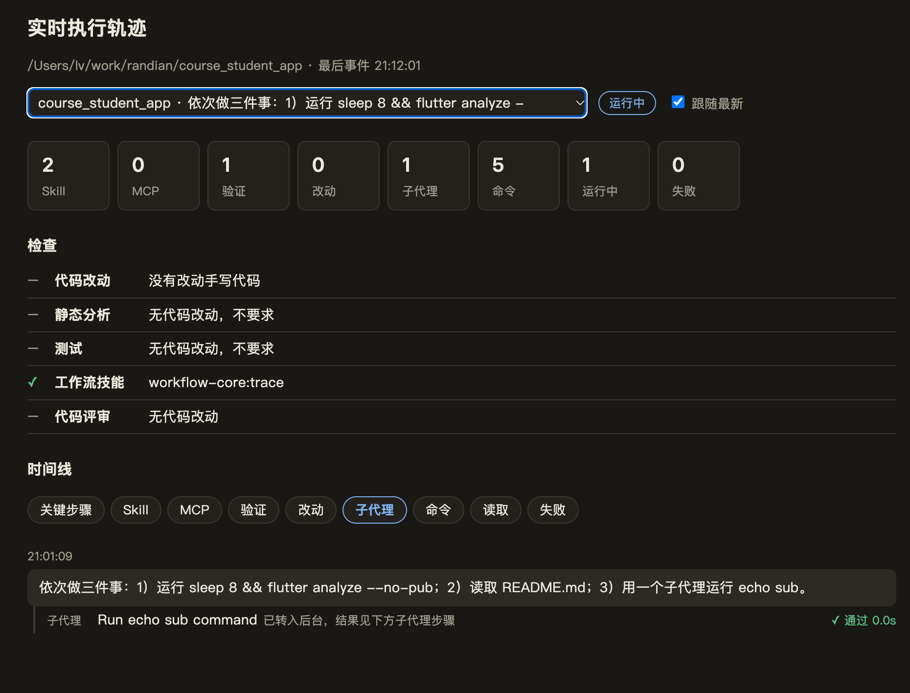
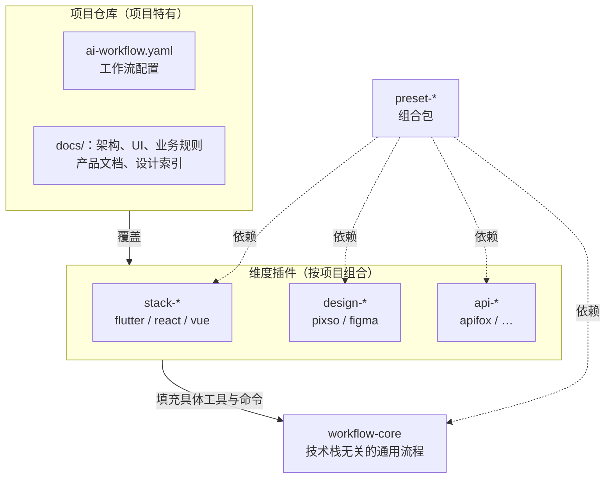
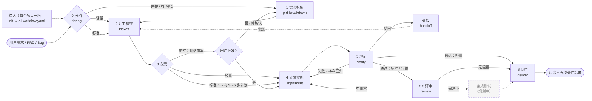
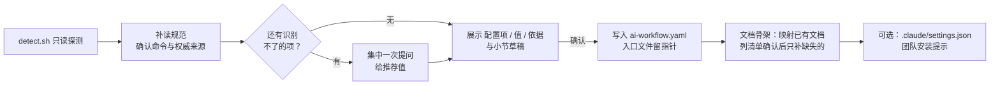
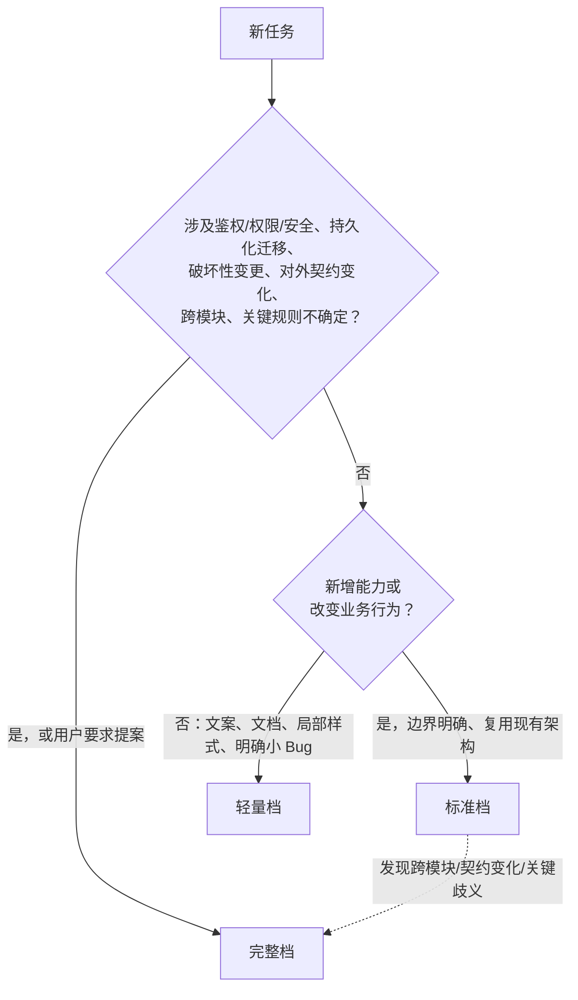
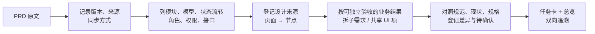
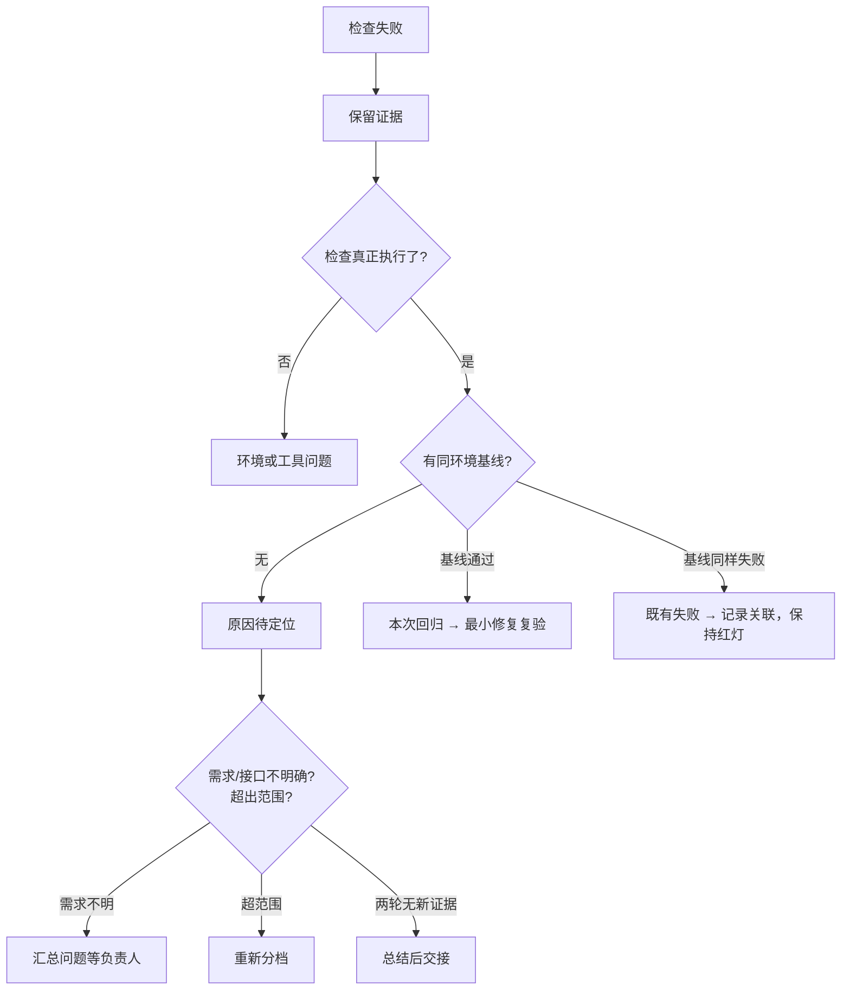
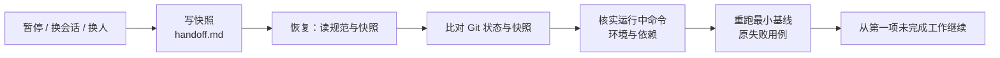
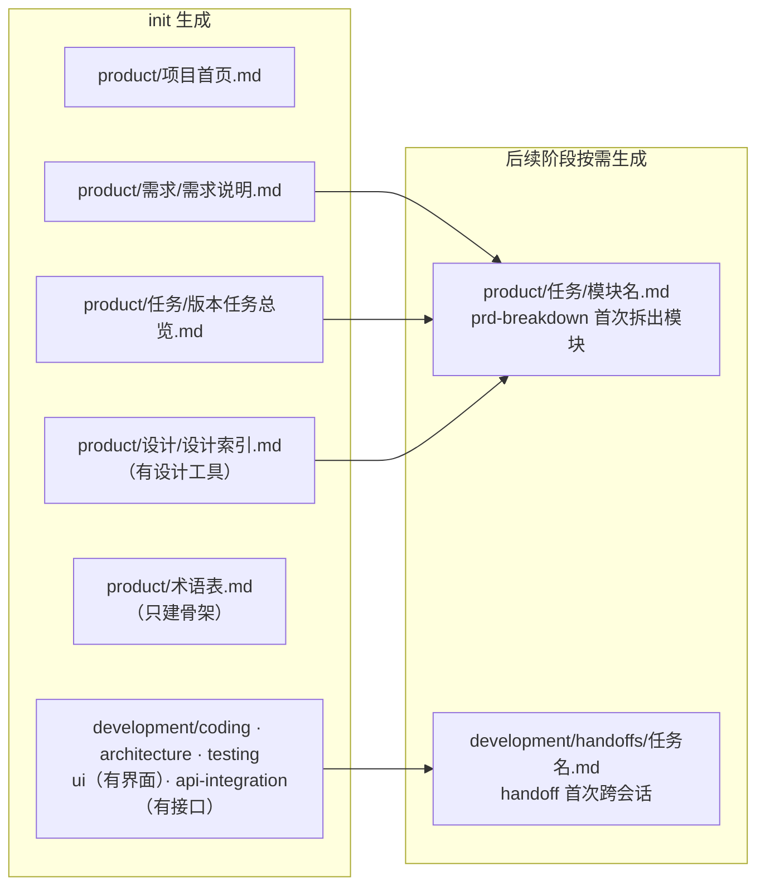
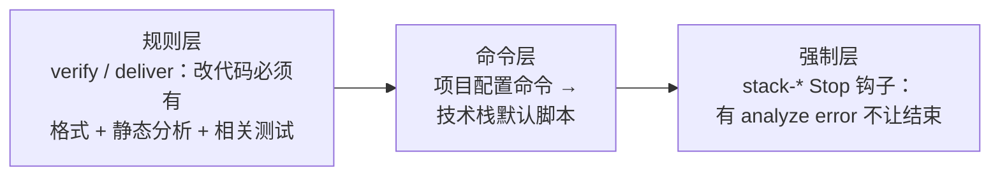

# ai-dev-workflow

面向 Codex 和 Claude Code 的 AI 协作开发工作流插件集。把“需求 PRD → 拆解 → 开工 → 实施 → 验证 → 交付”的流程沉淀成可复用的技能，按**通用流程 / 技术栈 / 设计工具 / 接口工具**四个维度拆成插件，各项目按需组合安装。

> 提炼自 `course_student_app`（Flutter + Pixso + Apifox）的实际工作流。

## 特点

**让 AI 开发有流程、看得见、管得住，而且越用越准。**

| 特点 | 怎么做到 | 入口 |
| --- | --- | --- |
| **数据驱动进化** | 自动积累技能触发率、评审命中、钩子拦截和「待验证」比例，算出哪些规则有效、哪些该改、哪些可以删。只给候选，去留由人决定，安全类规则受保护 | `/workflow-core:metrics` |
| **执行过程可视化** | 实时显示 AI 正在调用的 Skill、MCP、验证命令、子代理和结果，告别黑盒；默认关闭，按需开启 | `/workflow-core:trace on` |
| **流程不靠自觉** | 技能不触发时有钩子兜底：会话开始说明入口，改了代码却没走交付，回合结束前自动提醒 | 接入 `init` 后自动生效 |
| **全程可控** | 按风险分轻量、标准、完整三档，流程成本和风险对齐；完整档先批准再分段实施；提交、发布、写入外部系统都要明确授权 | `tiering`、`implement` |
| **结果可检测** | Stop 钩子在 AI 结束回合前拦下分析错误；Spec + Standards 双轴评审；验证失败必须分类；本地和 CI 跑同一份文档检查，工具缺失报「受阻」而不是「通过」 | `verify`、`review`、`deliver` |
| **扩展到任意技术栈** | 通用流程与技术栈无关；技术栈、设计工具、接口工具各是独立维度，加一个 `stack-*` 插件就能接入新技术栈。目前内置 Flutter + Pixso + Apifox | [扩展指南](#扩展新增阶段技术栈或工具) |
| **两步接入** | 装插件后运行 `init`，自动探测项目并生成结构化配置和文档骨架，只问探测不出来的项 | `/workflow-core:init` |
| **中断可恢复** | 进度快照写进仓库，换会话、换人、换 Agent 都能按固定步骤接着做 | `handoff` |
| **规则不打架** | 流程在插件、事实在项目，同一条规则只保留一处；skill 按需加载，不占常驻上下文 | [规则优先级](#插件一览) |
| **数据留在本机** | 轨迹和度量只写本机。度量只存枚举、计数和规则名 | Codex 的 `$CODEX_HOME`（默认 `~/.codex/`）或 `~/.claude/` |

### 执行过程一目了然

在 Codex 中用 `$workflow-core:trace on`，在 Claude Code 中用 `/workflow-core:trace on`。打开输出的本地地址，可以看到工具步骤及验证覆盖情况。用完把参数改成 `off` 关闭。



## 目录

- [特点](#特点)
- [插件一览](#插件一览)
- [工作流全景](#工作流全景)
- [各阶段说明](#各阶段说明)
- [安装](#安装)
- [在项目中使用](#在项目中使用)
- [开发与发布本仓库](#开发与发布本仓库)
- [扩展：新增阶段、技术栈或工具](#扩展新增阶段技术栈或工具)
- [路线图](#路线图)

## 插件一览

| 插件 | 维度 | 内容 |
| --- | --- | --- |
| `workflow-core` | 通用流程 | 项目接入初始化（`init`）、文档规范检查脚本、总入口、三档分级、PRD 拆解、开工检查、分段实施、接口契约、第三方文档、验证与失败分类、双轴代码评审（`review`）、统一交付、中断交接、实时执行轨迹（`trace`）、流程度量报告（`metrics`） |
| `stack-flutter` | 技术栈 | 版本核对、默认检查脚本、Stop 钩子兜底静态分析、平台验证口径、评审清单、生成代码、常见坑 |
| `design-pixso` | 设计工具 | Pixso MCP 配置、节点定位、读取层级、视觉核对 |
| `api-apifox` | 接口工具 | Apifox CLI/MCP 接入、操作授权边界、与后端不一致时的处理 |
| `preset-flutter-pixso-apifox` | Claude Code 组合包 | 依赖以上四个 + 官方 `context7`、`superpowers`、`dart-flutter`（Dart and Flutter），一次装齐 |



**规则优先级**：用户本次指令 > 项目配置与 `docs/` > 维度插件惯例 > `workflow-core` 通用流程 > 其他技能的通用建议。

**分层原则**：每条规则问一句“换一个同技术栈的项目还成立吗”。不成立的（默认验证平台、具体接口项目、架构分层选型）留在项目里，不进插件。

## 工作流全景



轻量任务通常走 0 → 4 → 5 → 6，标准、完整档在交付前加 5.5 评审；只做需求整理的任务停在 1。中断交接（`handoff`）可以在任何阶段发生。

## 各阶段说明

### 接入 · `init`



已有配置时进入更新模式：逐项对比，只改有变化的行，保留手写的项目约定。不提交、不自动删改项目里重复的流程文档，只列出迁移建议。

### 0 分档 · `tiering`



| 档位 | 最小产物 | 批准 |
| --- | --- | --- |
| 轻量 | 会话或已有 Issue | 无 |
| 标准 | 卡或 Issue 内 3～5 步计划 + 证据 | 用户要求实施且规则清楚即可 |
| 完整 | proposal / 规格 / tasks（必要时 design） | 提案批准后实施，按段停下汇报 |

### 1 需求拆解 · `prd-breakdown`



- 每类事实只有一个权威位置：业务规则→需求说明，设计节点→设计索引，产品状态→模块卡，技术清单→规格 tasks。
- 缺项和冲突用统一格式登记（待确认｜影响｜负责人｜恢复条件｜来源），只暂停依赖部分。
- 完成勾选只与“已验收”一致。

### 2 开工检查 · `kickoff`

范围、工作区、环境、基线、UI 与设计、接口与数据、验证计划七项最小检查；缺关键契约或批准时不猜测、不继续依赖实现。

### 3～4 方案与实施 · `implement`、`api-contract`、`tech-docs`

- 完整档按 tasks 分段：共享底座一段，业务项每项一段；安全相关逻辑先写失败测试；每段结束验证、勾 tasks、停下汇报取舍。
- 结构调整与行为变更分开。
- 文档最小化：同一事实只维护一处，不追加“本轮方案/实施记录”。
- 接口先确认契约，Mock 与真实联调分开标注；第三方 API 先核对锁定版本再查 Context7。

### 5 验证 · `verify`



### 5.5 评审 · `review`

对固定范围的 diff 同时启动两个干净上下文的子代理，分开报告、不合并排序：

- **Spec**：对照规格变更和任务卡验收，找缺失、范围蔓延、实现可疑、验收场景缺测试、规格来源不一致。
- **Standards**：对照项目 `docs/` 规范、技术栈插件的“评审清单”和坏味道基线，找规范违反。

严重度按后果分为阻塞 / 应修 / 建议；有未解决的阻塞时交付不能写“可评审”。只报告、不改代码，范围默认是当前分支相对 `review.base_branch` 的 merge-base 加工作区改动。标准档交付前跑一次；完整档每段跑一次、结束后对整个分支再跑一次。

### 6 交付 · `deliver`

```text
结论：<实际状态>
1. 场景  2. 文件  3. 验证  4. 剩余  5. 同步
```

状态口径：实施完成待验证 / 可评审 / 可合并 / 已上线 / 受阻，互不替代。

### 横切 · `handoff`



不为恢复自动 reset / clean / stash；快照不保存凭据。

## 安装

### Codex

在本仓库根目录执行。以下命令已用 Codex CLI 0.163.0 验证：

```bash
codex plugin marketplace add "$PWD"
codex plugin add workflow-core@ai-dev-workflow
# Flutter + Pixso + Apifox 项目再装以下三个，可按需选装
codex plugin add stack-flutter@ai-dev-workflow
codex plugin add design-pixso@ai-dev-workflow
codex plugin add api-apifox@ai-dev-workflow
```

Codex 共用此仓库的 marketplace，四个插件各自提供 `.codex-plugin/plugin.json`。按需单独配置 Context7、Superpowers 和官方 Dart and Flutter，Apifox CLI 也需单独安装登录。Pixso MCP 已随 `design-pixso` 声明，首次使用按提示授权。

打开目标项目并新建 Codex 会话。在 CLI 的 `/hooks` 或桌面端的 **Settings → Hooks** 检查并信任要启用的钩子。首次接入时用 `$workflow-core:init` 生成 `ai-workflow.yaml` 和文档骨架，已有配置的项目直接用 `$workflow-core:workflow`。下文 Claude Code 的技能命令可在 Codex 中使用同名的 `$插件名:技能名`。

- **交付提醒**在已接入工作流的项目生效。检测到代码编辑后，回合结束时最多提醒一次，下一次编辑后重新检查。Shell 写入按命令文本推断，在子目录运行的相对路径命令可能漏记。Flutter 静态分析由独立的 Stop 钩子负责，发现错误时请求继续一轮。
- **执行轨迹**默认关闭，使用 `$workflow-core:trace on` 开启。Codex 版实时展示工具调用、补丁和验证，技能加载事件可能不出现在轨迹中。历史会话 HTML 导出读取 Claude Code 的会话格式。
- **流程度量**使用 `$workflow-core:metrics` 汇总评审、交付和 Flutter 拦截记录。技能触发率及据此推导的规则删除候选目前仅由 Claude Code 会话数据提供。

轨迹开关需要访问本机回环地址并写入 Codex 数据目录。沙盒拦截时，可在普通本地终端执行 [trace 技能](plugins/workflow-core/skills/trace/SKILL.md)中的命令。评审与交付度量的写入失败会单独报告。

参见 [OpenAI 插件打包文档](https://developers.openai.com/plugins/build/plugins) 和 [Codex 钩子文档](https://learn.chatgpt.com/docs/hooks)。

### Claude Code

#### 1. 添加 marketplace

```bash
# 团队成员：从 GitHub 仓库添加
claude plugin marketplace add lvzhiyi/randian-ai-workflow-native
```

#### 2. 安装插件

**先选安装范围**：插件只在启用它的范围内生效。

| 范围 | 参数 | 写入位置 | 生效范围 | 适合 |
| --- | --- | --- | --- | --- |
| user | 默认（不加） | `~/.claude/settings.json` | 你本机所有项目 | `workflow-core`：和技术栈无关，装一次处处可用 |
| project | `--scope project` | 项目 `.claude/settings.json`（进 git） | 该项目，团队共享 | 技术栈、设计、接口插件和 preset |
| local | `--scope local` | 项目 `.claude/settings.local.json`（不进 git） | 该项目，只有你自己 | 个人试用 |

> 常见坑：用 `--scope local` 装过后，换到别的项目会看到插件被列出但显示 `disabled`，也没有 `/workflow-core:init`。marketplace 是用户级的所以能列出，启用只记录在原项目里。需要的话在新项目再装一次，或把 `workflow-core` 装成 user 范围。

推荐组合：`workflow-core` 装 user 范围；进入新项目后先跑 `/workflow-core:init`，它会按技术栈建议该装哪些维度插件。

一次装齐（Flutter + Pixso + Apifox 项目）：

```bash
claude plugin install preset-flutter-pixso-apifox@ai-dev-workflow
```

或按维度单独安装：

```bash
claude plugin install workflow-core@ai-dev-workflow
```

`preset` 还依赖三个外部插件，本仓库 `marketplace.json` 已把它们所在的 marketplace 加入跨 marketplace 白名单：

| 插件 | 所在 marketplace | 本机需要 |
| --- | --- | --- |
| `context7`、`superpowers` | `claude-plugins-official` | 内置，无需操作 |
| `dart-flutter`（官方 Dart and Flutter：Flutter/Dart 技能 + Dart MCP server） | `dart-flutter`（`flutter/agent-plugins`） | **安装 preset 前先添加**，见下 |

```bash
claude plugin marketplace add flutter/agent-plugins
```

依赖解析不会自动添加 marketplace：没添加时 preset 能装上，但会提示 `dart-flutter` 未安装且 preset 显示加载失败。preset 本身没有内容，**不影响** workflow-core、stack-flutter 等插件正常工作；补上 marketplace 后重新执行 `install` 即可。用项目 `.claude/settings.json` 分发时（见下文）已包含这个 marketplace，团队成员不用手动添加。

> `dart-flutter` 也出现在内置的 Anthropic 插件目录里，但 CLI 无法按名称从内置目录解析它，所以依赖指向它自己的 marketplace。

### 额外前置

- **Apifox CLI 与官方技能**：按 [Apifox CLI 安装指南](https://apifox.com/apifox-cli-installation-guide.md) 安装登录，令牌只留在本机。
- **Pixso MCP**：`design-pixso` 已内置 `https://pixso.cn/mcp`，首次调用按提示授权。用户级已配过同名 Pixso MCP 的，删掉一处避免工具重复。
- **OpenSpec**（如项目使用）：按项目说明安装。

## 在项目中使用

### 1. 初始化：工作流配置 + 文档骨架（每个项目一次）

在项目里执行：

```
/workflow-core:init
```

它会只读扫描项目（技术栈、OpenSpec、`.apifox/`、设计链接、`docs/` 结构、检查脚本与 CI），只就识别不了的项提问（如默认验证平台、多个候选设计文件），展示「配置项 | 值 | 依据」后经你确认写入项目根目录的 `ai-workflow.yaml`（入口文件只留一行指针），并可按需生成 `.claude/settings.json` 的插件提示。

接着补齐流程需要的文档骨架（已有同类文档的只做映射，不新建；已有文件一律不覆盖）。

**流程在插件里，事实在项目里**：三档、拆解、交接、交付这些流程说明由插件技能承载，项目里**不需要** `ai-workflow.md` 之类的流程文档；项目只放流程的输入和产物。



| 文档 | 维护什么 | 被哪些技能使用 |
| --- | --- | --- |
| 项目首页 | 文档导航与协作约定 | `handoff` 恢复时定位 |
| 需求说明 | 业务规则、待确认问题 | `prd-breakdown`、`kickoff` |
| 版本任务总览 / 模块卡 | 模块优先级 / 子需求状态与验收 | `prd-breakdown`、`check_docs.py` |
| 设计索引 | 设计文件、节点映射、主稿确认 | `prd-breakdown`、`design-*` |
| 术语表 | 已确认的业务术语、避免用词、代码命名 | `prd-breakdown`、`review`、`check_docs.py` |
| coding / architecture / ui / api-integration / testing | 项目工程约定与检查命令 | `kickoff`、`implement`、`verify`、`api-contract` |

模板在 [`templates/docs/`](plugins/workflow-core/templates/docs/)。init 用探测到的事实填写（如 `testing.md` 的真实命令、`architecture.md` 按现有目录推断的分层并标「待确认」），不留空壳。

这份配置和文档**按项目写一次、提交进 git**，团队成员和其他 Agent 共用，不需要每人手写。项目约定变化时再次运行 `init` 会进入更新模式，只改有变化的键。字段和格式说明见 [`templates/ai-workflow.yaml`](plugins/workflow-core/templates/ai-workflow.yaml)。

**配置格式**：YAML 受限子集（两层映射、逐行字符串列表、`#` 注释），由插件自带的 [`workflow_config.py`](plugins/workflow-core/scripts/workflow_config.py) 读取，不依赖 PyYAML，Python 3.8+ 标准库即可。写了子集以外的语法或未知键时报“执行受阻”并给出行号，不会静默回退默认值；`check_docs.py --check-config` 额外检查配置里的路径是否存在。只读 `ai-workflow.yaml`，不再读取 AGENTS.md 里的旧「工作流配置」小节。

**术语表**：`docs.glossary` 指向项目术语表（默认 `docs/product/术语表.md`），不放进配置。`init` 只建骨架；`prd-breakdown` 遇到含糊词提议入表，`review` 检查命名是否符合词条，用户确认后才写入。

### 2. 让 Claude Code 团队成员打开项目就收到安装提示

在项目 `.claude/settings.json` 写入：

```json
{
  "extraKnownMarketplaces": {
    "ai-dev-workflow": {
      "source": { "source": "github", "repo": "lvzhiyi/randian-ai-workflow-native" }
    },
    "dart-flutter": {
      "source": { "source": "github", "repo": "flutter/agent-plugins" }
    }
  },
  "enabledPlugins": {
    "preset-flutter-pixso-apifox@ai-dev-workflow": true
  }
}
```

成员信任该目录后，Claude Code 会提示添加 marketplace 并安装插件。依赖其他 marketplace 的插件，要把那些 marketplace 也列进 `extraKnownMarketplaces`（`init` 会自动处理）。

### 3. 日常使用

技能会根据任务自动触发，也可以手动调用：

| 场景 | 调用 |
| --- | --- |
| 项目第一次接入 / 约定变化 | `/workflow-core:init` |
| 不确定从哪开始 | `/workflow-core:workflow` |
| 拿到一份 PRD | `/workflow-core:prd-breakdown` |
| 判断档位 | `/workflow-core:tiering` |
| 交付前评审改动 | `/workflow-core:review` |
| 查看流程度量报告 | `/workflow-core:metrics` |
| 实时查看执行轨迹（可选，默认关闭） | `/workflow-core:trace on`，`off` 关闭 |
| 写最终交付 | `/workflow-core:deliver` |
| 要换会话 / 接手任务 | `/workflow-core:handoff` |

### 4. 从现有项目迁移

一次搬一个流程，搬完就在项目文档里删掉对应段落，只留一句“见 `workflow-core:<技能>`”。**同一条规则只保留一处**，否则模型会拿到两套说法。

以 `course_student_app` 为例：

| 原位置 | 去向 |
| --- | --- |
| `ai-workflow.md` 三档、减少重复、文档最小化、开工、失败分类、交接、交付、完成状态、Context7 | `workflow-core` |
| `ai-workflow.md` Apifox 接口契约 | `api-apifox` |
| `api-integration.md` 契约清单、Mock 与真实联调、测试数据 | `workflow-core:api-contract`；项目 `NetManager`、环境变量等接入边界留项目 |
| `需求拆解与执行流程.md` 第 1～7、9 节 | `workflow-core:prd-breakdown` + `templates/task-card.md` |
| `需求拆解与执行流程.md` 第 8 节、默认只验 Android | 项目「工作流配置」 |
| `scripts/check.py docs` 的链接与任务卡检查 | `workflow-core/scripts/check_docs.py`；`check.py` 保留 `git diff --check` 与 `full` 的 Flutter 检查 |
| `architecture.md`、`ui.md`、`coding.md` | 留在项目（项目特有） |

## 开发与发布本仓库

```text
ai-dev-workflow/
├── .claude-plugin/marketplace.json     # marketplace 清单 + 跨 marketplace 白名单
└── plugins/
    ├── workflow-core/
    │   ├── .claude-plugin/plugin.json 和 .codex-plugin/plugin.json
    │   ├── hooks/hooks.json 和 hooks/codex.json
    │   ├── skills/<阶段>/SKILL.md       # 每个阶段一个技能
    │   ├── skills/init/detect.sh        # init 用的只读项目探测脚本
    │   ├── scripts/check_docs.py        # 文档规范检查（链接/锚点、任务卡字段、待确认格式）
    │   └── templates/                   # 项目配置、交接、受阻、任务卡模板
    ├── stack-flutter/
    │   ├── scripts/flutter_check.py     # 默认检查：格式 + analyze + 测试
    │   ├── scripts/stop_analyze.py      # Stop 钩子脚本
    │   └── hooks/                       # 两个客户端各自的 Stop 钩子配置
    ├── design-pixso/                    # 含 .mcp.json
    ├── api-apifox/
    └── preset-flutter-pixso-apifox/     # 只有 plugin.json 的 dependencies
```

- **边改边用**：Claude Code 本地 marketplace 修改后可执行 `/reload-plugins`，临时调试也可用 `claude --plugin-dir ./plugins/workflow-core`。Codex 本地插件修改后重新安装并打开新会话，钩子脚本变更后在 Hooks 中重新审核。
- **校验**：提交前运行插件校验和脚本单测。

  ```bash
  for p in plugins/*/; do claude plugin validate "$p" --strict; done
  ```

- **发版**：确认可用后，在插件目录升级 `plugin.json` 的 `version`，然后执行：

  ```bash
  claude plugin tag --push
  ```

  tag 格式为 `<插件名>--v<版本>`，依赖方的版本约束（如 `^0.2`）按 tag 解析。`0.x` 表示仍在变动。

## 插件自带脚本

| 脚本 | 用途 | 调用方 |
| --- | --- | --- |
| `workflow-core/skills/init/detect.sh` | 只读探测项目技术栈、规格/设计/接口工具、文档结构、检查命令 | `init` 技能 |
| `stack-flutter/scripts/flutter_check.py` | 改动文件格式检查 + `flutter analyze` + 测试；项目没配置检查命令时的默认检查 | `verify`、`stack-flutter:flutter` 技能 |
| `stack-flutter/scripts/stop_analyze.py` | Stop 钩子：结束回合前对改动的 Dart 文件跑 `dart analyze`，有 error 让 AI 先修 | `stack-flutter/hooks/hooks.json` |
| `workflow-core/scripts/check_docs.py` | 只读检查文档本地链接与锚点、任务卡必填字段、「待确认」五段格式、术语表词条；路径读 `ai-workflow.yaml`，可用参数覆盖；`--check-config` 检查配置路径 |
| `workflow-core/scripts/trace_hook.py`、`trace_server.py` | 可选的执行轨迹：钩子把工具调用写入本机日志，本地页面实时展示；默认关闭 | `trace` 技能、`hooks/hooks.json` |
| `workflow-core/scripts/workflow_metric.py` | 把评审、交付结论写成结构化度量（只存枚举、计数和规则名，默认开启；`off` 关闭），`stack-flutter` 的 Stop 钩子写入同一文件 | `review`、`deliver` 技能 |
| `workflow-core/scripts/workflow_gate.py` | 触发兜底：接入项目的会话开始时说明工作流入口，代码改动后缺交付时在回合结束提醒。可在客户端数据目录的 `workflow-gate/` 下创建 `disabled` 文件关闭 | `hooks/hooks.json`、`hooks/codex.json` |
| `workflow-core/scripts/metrics_report.py` | 汇总触发率、评审阻塞、拦截、待验证比例，生成规则命中表和删除候选（只读） | `metrics` 技能 |
| `workflow-core/scripts/workflow_trace.py` | 从 Claude Code 会话记录事后生成单页轨迹 | 手动运行 |
| `workflow-core/scripts/workflow_config.py` | 解析与校验 `ai-workflow.yaml`（YAML 受限子集） | `prd-breakdown`、`verify` 技能；项目 CI |

**插件不依赖项目脚本**：技能只调用插件自带的脚本，项目里没有 `check.py` 之类的入口也能正常工作；项目有自己的检查入口时，写进「工作流配置」后优先使用项目的。

**代码检查不会被漏掉**：分三层保证。



**哪些脚本放插件、哪些留项目**：只服务 AI 工作流、与具体项目无关、项目离开它照样能运行，三条都满足才放插件。构建、发布、代码生成、提交钩子、`flutter analyze/test` 这类项目运行要依赖的脚本留在项目里，否则没装插件的 CI 和同事就跑不了。

**在 CI 中运行文档检查**：CI 里没有 Claude 插件，额外签出本仓库的固定 tag 运行同一份脚本，版本可复现：

```yaml
- uses: actions/checkout@v4
  with:
    repository: lvzhiyi/randian-ai-workflow-native
    ref: workflow-core--v0.13.0
    path: .ai-workflow
- run: python3 .ai-workflow/plugins/workflow-core/scripts/check_docs.py --root .
```

本地手动运行（Python 3.8+，仅标准库）：

```bash
python3 ~/.claude/plugins/cache/ai-dev-workflow/workflow-core/<版本>/scripts/check_docs.py --root .
```

修改脚本后跑单测：

```bash
python3 -m unittest discover -s plugins/workflow-core/scripts -p 'test_check_docs.py'
```

```bash
python3 -m unittest discover -s plugins/stack-flutter/scripts -p 'test_*.py'
```

## 扩展：新增阶段、技术栈或工具

- **新增流程阶段**：在 `workflow-core/skills/` 下新建 `<阶段>/SKILL.md`，在 `workflow` 技能的阶段地图和本 README 的全景图里登记。技能里只写抽象步骤，具体命令留给维度插件或项目配置。
- **新增技术栈**（如 `stack-vue`）：复制 `stack-flutter` 结构，只写该栈的通用惯例；在 `marketplace.json` 登记；按需新建 preset。
- **新增设计/接口工具**（如 `design-figma`）：MCP 配置放插件 `.mcp.json`，凭据用环境变量或 `userConfig` 的 `sensitive` 字段，不写进仓库。
- **强制规则**：靠文字约束不可靠的，用插件 `hooks/hooks.json` 兜底，参考 `stack-flutter` 的 Stop 钩子。新技术栈插件（如 `stack-vue`）可以照此用 `tsc --noEmit` / `eslint` 实现同样的兜底。

## 路线图

| 阶段 | 计划 | 状态 |
| --- | --- | --- |
| 代码评审 | `workflow-core:review`：Spec + Standards 双轴评审，严重度口径与交付衔接 | 已实现（workflow-core 0.6.0） |
| 评审测试有效性 | `review` 可选步骤：安全相关和 Bug 修复的新测试在父提交上应失败（临时 worktree 中验证） | 规划中，出现真实问题时再做 |
| 集成测试 | `workflow-core:integration-test`：从任务卡验收场景生成测试用例 → 环境与数据准备 → 执行 → 结果回写卡片；Apifox 场景执行放 `api-apifox` | 规划中 |
| 其他技术栈 | `stack-react`、`stack-vue` | 有对应项目时再建 |
| 其他设计工具 | `design-figma`（官方 `figma` 插件可作依赖） | 有对应项目时再建 |
