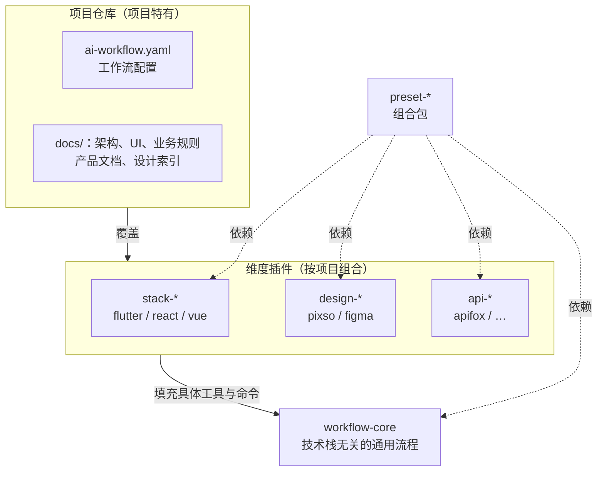
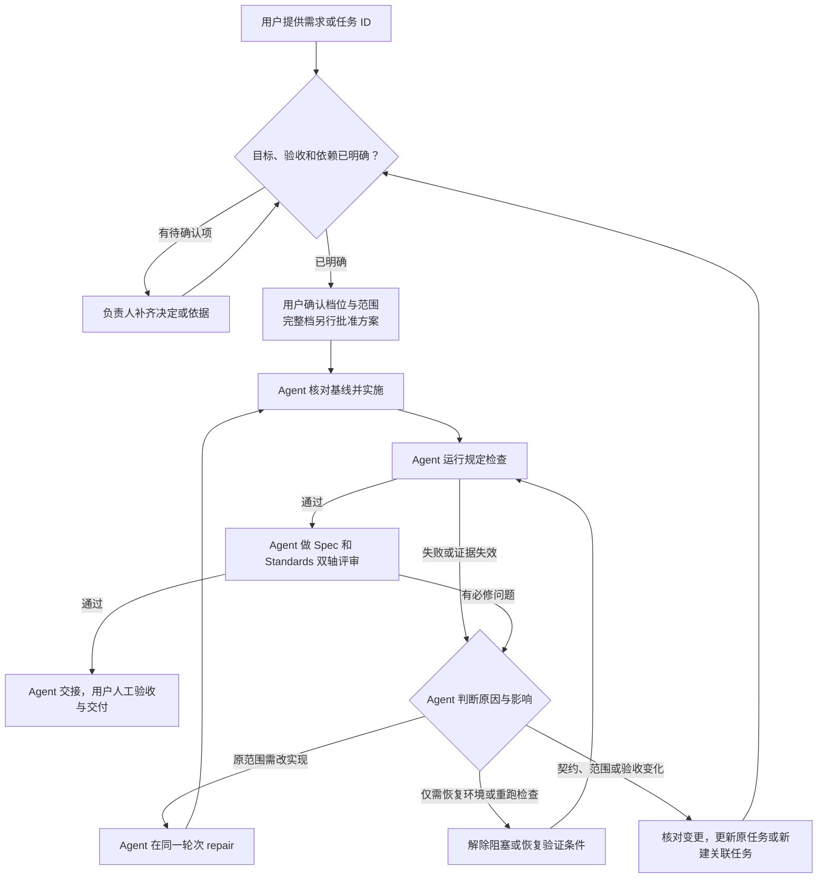
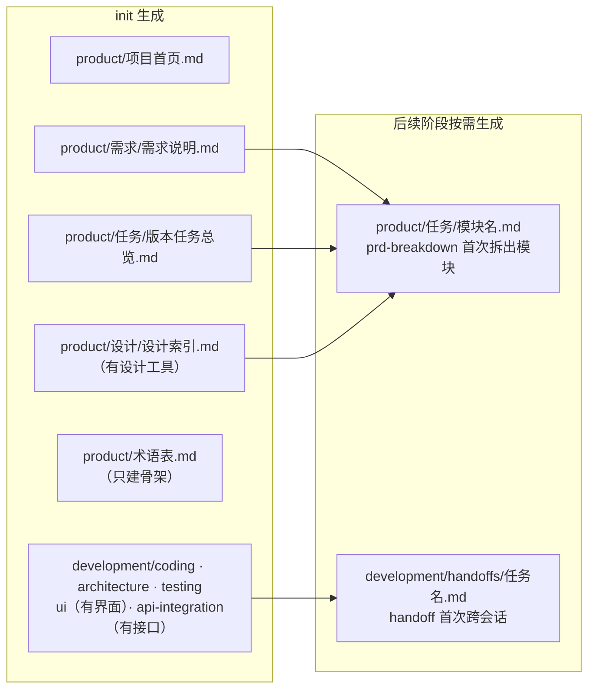

# SpecLock

[English](README.md) | **简体中文**

面向 **Claude Code、Codex 和 Cursor** 的任务级 AI 协作开发工作流引擎与插件集。通过 **Hooks + SQLite 状态机 + SHA-256 必读基线回执** 硬强制执行工程纪律，零第三方依赖（仅 Python 标准库），**技术栈无关**，按「通用流程 / 技术栈 / 设计工具 / 接口工具」四维自由组合。

> **Superpowers 用提示词教 AI 守纪律；SpecLock 用 Hooks + SQLite 状态机 + SHA-256 基线回执硬强制执行**——AI 不完整读完你的规范写不了代码，不真实跑完验证过不了评审。内置 Flutter + Pixso + Apifox 示例维度插件，也欢迎按任何技术栈扩展。

### 30 秒本地体验（不污染你的项目）

```bash
git clone https://github.com/lvzhiyi/speclock.git
cd speclock
python3 examples/workflow-sandbox/scripts/check.py docs
python3 -m unittest discover -s plugins/workflow-core/scripts/tests_engine -p 'test_cli.py'
```

## 特点

**让 AI 开发有流程、看得见、管得住，而且越用越准。**

| 特点 | 怎么做到 | 入口 |
| --- | --- | --- |
| **数据驱动进化** | 自动积累技能触发率、评审命中、钩子拦截和「待验证」比例，算出哪些规则有效、哪些该改、哪些可以删。只给候选，去留由人决定，安全类规则受保护 | `/workflow-core:metrics` |
| **任务执行可观测** | 在只读看板查看任务进度、轮次、验证尝试和评审证据 | `/workflow-core:dashboard` |
| **流程防护栏** | 开工前核对必读基线 SHA-256 完整读取回执；评审前确认规定检查实际跑过且源码快照一致；写门禁覆盖宿主支持的工具路径 | `workflow` |
| **低摩擦引擎链路** | 提供 `prepare`（自动从配置派生基线与检查计划）→ `begin`（批量吐出基线正文 + 开工 + TDD）→ `finish-step --finish-implementation` 精简入口，内联 `progress` 投影，兼顾硬门禁与低往返 | `workflow`、`kickoff` |
| **全程可控** | 按风险分轻量、标准、完整三档，流程成本和风险对齐；完整档先批准再分段实施，合入后一键归档并查断链；提交、发布、写入外部系统均须明确授权 | `tiering`、`implement`、`archive` |
| **结果可检测 & 自包含** | 三档规定验证与 Agent Spec + Standards 两轴通过后回写「评审通过，待人工验收」；可导出零第三方依赖的单文件 `scripts/check_docs.py` 入库，硬拦截任务卡 `[x]` 与非终态冲突，跨 CI/沙箱零脆断 | `verify`、`review`、`deliver` |
| **扩展到任意技术栈** | 通用流程与技术栈无关；技术栈、设计工具、接口工具各是独立维度，加一个 `stack-*` 插件就能接入新技术栈。目前内置 Flutter + Pixso + Apifox | [扩展指南](#扩展新增阶段技术栈或工具) |
| **两步接入 & 轻骨架** | 装插件后运行 `init`，自动探测项目并生成配置和骨架；中小项目可选单文件核心基线 `docs/development/standards.md`（≤200 行），避免文档过载 | `/workflow-core:init` |
| **中断可恢复** | 进度快照写进仓库，换会话、换人、换 Agent 都能按固定步骤接着做 | `handoff` |
| **规则不打架** | 流程在插件、事实在项目，同一条规则只保留一处；任务卡只保留 7 个核心业务字段，执行轮次归引擎、历史变更归 Git | [规则优先级](#插件一览) |
| **数据留在本机** | 度量记录写在本机，只存枚举、计数和规则名 | Codex 的 `$CODEX_HOME`（默认 `~/.codex/`）或 `~/.claude/` |

### 任务执行与证据一目了然

用 `/workflow-core:dashboard`（Codex 用 `$workflow-core:dashboard`）查询任务级只读看板。默认查询状态，显式传入 `on` 才启动本机服务。看板展示当前轮次的实施进度、验证尝试和双轴评审证据。人工定档和方案批准在 Agent 窗口进行。

Cursor 的 `workflow-core` 使用独立插件清单和 hooks。用户在聊天中回复档位或批准方案，Agent 通过 CLI 读取基线并登记回执。安装与宿主覆盖范围见 [Cursor 适配说明](docs/development/cursor-adapter.md)。

## 目录

- [特点](#特点)
- [与 Superpowers 的关系：增强与优势](#与-superpowers-的关系增强与优势)
- [插件一览](#插件一览)
- [工作流全景](#工作流全景)
- [各阶段说明](#各阶段说明)
- [安装](#安装)
- [在项目中使用](#在项目中使用)
- [扩展：新增阶段、技术栈或工具](#扩展新增阶段技术栈或工具)

## 与 Superpowers 的关系：增强与优势

[Superpowers](https://github.com/obra/superpowers) 是广受欢迎的通用工程方法论技能包，擅长需求头脑风暴（`brainstorming`）、计划拆解、严格 TDD、系统调试与子 Agent 分段执行。**SpecLock 与 Superpowers 并非互斥替代，而是面向真实团队业务交付的增强与上层治理**（本仓库的 `preset-flutter-pixso-apifox` 本身已将 `superpowers` 纳入组合依赖）。

在保留开发轻快感的同时，SpecLock 针对多 Agent 实战中最容易失控的环节做了 **5 项核心增强**：

| 维度 | Superpowers（通用方法论） | SpecLock 的增强与优势 |
| --- | --- | --- |
| **约束强度** | 纯 Prompt / Skill 软纪律；长上下文或模型偷懒时仍可能漏读规范、跳过测试或口头报“已通过” | **Hooks + SQLite 状态机硬门禁**：未完整读取 `baseline.required`（带 SHA-256 与字节回执，截断拒写）拦写入；未人工定档/批方案拦写入；`run` 校验真实退出码与前后源码快照一致性 |
| **流程弹性与移动端适配** | 默认强硬 TDD（无先红测试即拒写代码），对纯逻辑极佳，但在 UI/布局/文档任务上偏教条 | **三档风险分级（轻量/标准/完整）+ 务实 TDD**：按风险匹配成本，TDD 优先非强制（不采用记录原因与替代验证）；原生支持平台裁剪（如默认仅验 Android、iOS 按需） |
| **业务与外部系统闭环** | 聚焦单仓代码生成，不管 PRD、任务卡、设计稿、接口契约与文档一致性 | **端到端团队研发闭环**：打通 PRD 拆解（`prd-breakdown`）、7 字段精简任务卡自动回写、`[x]` 与非终态硬拦截、`design-pixso` 设计节点、`api-apifox` 接口契约及变更归档（`archive`） |
| **跨环境可移植与执行效率** | 零配置轻快，但缺少团队统一基线校验与归档工具 | **仓库自包含 + 精简 CLI 链路**：`vendor_check_docs.py` 导出零第三方依赖单文件 `scripts/check_docs.py`，CI/容器/沙箱零脆断；`prepare → begin → finish-step --finish-implementation → run → review` 将流程 CLI 压至 4～5 步 |
| **可观测与持续进化** | 主要依赖聊天记录与静态进度文件 | **任务级只读 Dashboard + Metrics 度量**：轮次/尝试/证据全程结构化审计，跨会话 `handoff` 精确恢复，`/workflow-core:metrics` 数据驱动识别无效规则 |

**推荐搭配方式**：以 SpecLock 作为团队项目的主干与硬底线（管定档审批、必读基线防漏读、真实验证快照、双轴评审、任务卡回写与变更归档）；遇到开放式架构探索或复杂疑难 Bug 时，按需叠加 Superpowers 的 `brainstorming`、`systematic-debugging` 或 `test-driven-development`，兼得硬治理与高灵活度。

## 插件一览

| 插件 | 维度 | 内容 |
| --- | --- | --- |
| `workflow-core` | 通用流程 | 项目接入初始化（`init`）、零依赖单文件文档检查导出（`vendor_check_docs.py`）与检查脚本（`check_docs.py`）、总入口、三档分级、PRD 拆解、任务就绪检查、精简引擎 CLI（`prepare`/`begin`）、分段实施、接口契约、第三方文档、验证与失败分类、双轴代码评审（`review`）、统一交付、变更归档（`archive`）、中断交接、任务级只读看板（`dashboard`）、流程度量报告（`metrics`） |
| `stack-flutter` | 技术栈 | 版本核对、默认检查脚本、Stop 钩子兜底静态分析、平台验证口径、评审清单、生成代码、常见坑 |
| `design-pixso` | 设计工具 | Pixso MCP 配置、节点定位、读取层级、视觉核对 |
| `api-apifox` | 接口工具 | Apifox CLI/MCP 接入、操作授权边界、与后端不一致时的处理 |
| `preset-flutter-pixso-apifox` | Claude Code 组合包 | 依赖以上四个 + 官方 `context7`、`superpowers`、`dart-flutter`（Dart and Flutter），一次装齐 |



**规则优先级**：用户本次指令 > 项目配置与 `docs/` > 维度插件惯例 > `workflow-core` 通用流程 > 其他技能的通用建议。

**分层原则**：每条规则问一句“换一个同技术栈的项目还成立吗”。不成立的（默认验证平台、具体接口项目、架构分层选型）留在项目里，不进插件。

## 工作流全景

接入配置（`init`）按项目进行；日常以任务为单位推进，不使用全局八步状态：

1. **需求接收与拆解**（`prd-breakdown`）：记录目标、范围/非目标、验收、来源与依赖；小任务可在会话/Issue 原位简记，不强制 PRD。
2. **任务就绪检查**（`kickoff`、`tiering`）：核对缺项、人工定档与范围、计划和适用基线；未就绪可调查，不可实施。
3. **实施**（`implement`）：成功完整读取必读基线后按 todos 推进；TDD 优先非强制，不采用按任务/步骤写原因及替代验证，不增加豁免审批。
4. **验证**（`verify`）：沿用 `verify.light/standard/full` 与平台配置，逐项真实执行；遗漏、失败、异常或失效都不能写通过。
5. **Agent 双轴评审**（`review`）：所有档位都做 Spec + Standards，规定验证全部通过且两轴通过、证据有效后为“评审通过”（`review_passed`），这是 Agent 终态。
6. **Agent 总结与人工交接**（`deliver`）：总结范围、证据、剩余和下一步；后续人工验收/交付另行记录，不能自动宣称产品完成。

`handoff` 可在任何阶段保存和恢复；Dashboard 提供任务级只读查询。只授权需求整理时不会自动进入产品实施。

## 用户侧操作指南

在已初始化的项目中，Codex 用 `$workflow-core:workflow`，Claude Code 用 `/workflow-core:workflow`，Cursor 可在聊天里指定 `workflow-core:workflow`。开新任务时给出目标、来源和验收条件。续做或调整已有任务时给出任务 ID（或任务卡链接）和新情况，由 Agent 查当前轮次并说明下一步。



任何阶段发现新信息，都可以回到就绪检查。先区分**待确认**和**阻塞**。待确认需要负责人给出决定或权威依据，阻塞需要补齐实际执行条件。两者都只暂停受影响的部分。

待实施和待确认都可以直接说「执行 T1」。Agent 会先查来源，主动问仍需用户决定的关键问题。收到明确答复并复核通过后，Agent 在同一会话继续实施。

### 各阶段遇到问题怎么处理

| 阶段或情况 | 你需要做什么 | Agent 接下来做什么 |
| --- | --- | --- |
| **待确认** · 需求、设计、接口或验收有冲突 | 回答 Agent 的具体问题，或指出决定人和依据。<br>**可以这样回复**「以接口负责人确认的 v2 契约为准，空列表返回 `items: []`。」 | 先查权威来源，再主动问需要人决定的问题，并说明建议和影响。登记未决依赖，等答复后复核就绪条件，通过即继续 |
| **待定档或批准** · 开工前或范围变化后 | 核对任务范围，按提示选择档位。完整档看到提案、技术设计和实施步骤后，再单独批准方案。<br>**可以这样回复** 按 Agent 的提示单独发送 `选标准档`。若选择完整档，审阅方案后按提示单独发送 `批准方案`。 | 核实引擎回执和必读基线，满足就绪条件后开工。聊天选档和批准方式见[三档、计划与批准](#三档计划与批准) |
| **阻塞** · 缺权限、环境、设备、可用账号或上游交付 | 查看 Agent 列出的缺项，只补需要你处理的条件。例如提供测试环境入口和账号角色，凭据通过团队约定渠道交接。<br>**可以这样说**「T1 的测试环境已恢复，仍使用原测试账号。请重跑原失败检查，有缺项就列出我需要补的条件。」 | 先尝试在授权范围内排查。需外部协助时写明受影响范围、负责人和恢复条件，条件恢复后复核并重跑原检查 |
| **验证失败或评审有必修问题** | 若目标和范围仍适用，可让 Agent 按原范围修。需要接受新行为或扩大范围时，确认新的验收和范围。<br>**可以这样说**「请核对 T1 的失败记录。若是原范围内的实现问题，就在本轮修复，重跑检查并重新评审。」 | 保留失败证据并定位原因。只需重跑时新增验证尝试。需要修改实现且当前为 `failed`、`review_failed` 或 `stale` 时，可在原授权范围内 `repair`，完成后重新验证和评审。超出范围时按下节处理 |
| **证据失效** · 工作区、基线或验证配置变化 | 提供已知变更来源。涉及任务目标、范围或验收变化时，确认新要求。<br>**可以这样说**「T1 上次评审后合入了新提交。请核对上次验证对应的版本，补跑受影响的检查。」 | 核对哪些输入和证据受影响，按需重读基线、复验或重新授权 |
| **中断或换会话** | 给出任务 ID 和已有交接链接，也可请 Agent 先保存 `handoff`。<br>**可以这样说**「请接着做 T1，交接记录在【链接】。先核对当前轮次，从第一项未完成的步骤继续。」 | 读取引擎状态，核对工作区和未完步骤，复用有效轮次和授权，按需重读基线。活动未知时先查证据 |
| **已取消，想重新启动** | 决定是否退回原任务重做。若决定继续，由你执行 `return-task`。<br>**可以这样说**「T1 之前因后端未就绪取消，现在接口已可联调。我想退回原任务重做，请给我可直接执行的 `return-task` 命令。」 | 提供退回命令，检查新轮次的就绪和授权条件。`resume` 只用于继续现有轮次 |
| **评审通过，待人工验收** | 按交接中列出的版本和场景验收，记录人员、时间、范围、结论和依据。发现问题时说明预期与实际结果。<br>**可以这样说**「我在 T1 的交接版本【版本号】验收时发现，空列表应显示空态，实际一直加载。请登记这条验收反馈，并给我退回原任务的命令。」 | 给出验证、评审和未覆盖项的证据。需要按原任务退回时，提供对应的人工操作命令 |

查看当前进度可用[只读看板](plugins/workflow-core/skills/dashboard/SKILL.md)，失败分类与恢复步骤见[验证技能](plugins/workflow-core/skills/verify/SKILL.md#失败处理顺序)。

### 修正原任务，还是登记变更

| 你发现的情况 | 处理方式 |
| --- | --- |
| **原契约一直是 `string`，实现误写成 `number`** | 保留原任务和验收。实施中在原范围内修正。验证、评审失败或证据失效后需要追加实现步骤时，由 Agent 使用 `repair`，沿用当前轮次和有效授权 |
| **按原验收应退回重做** · 例如人工验收发现一个已通过评审的任务仍有问题 | 由用户执行 `return-task` 开新轮次，保留原轮次和历史证据。Agent 按新轮次办理就绪与授权，再实施、验证和评审 |
| **权威契约正式从 `number` 改为 `string`，原任务还未交付** | 可沿用原任务 ID。未开始执行时，由 Agent 用 `update-task` 更新任务。已执行且需要保留旧轮次时，用户先 `return-task`，Agent 再在新轮次 `update-task`。范围、验收或实质方案改变时重新确认授权，外部契约变化按完整档走方案批准 |
| **原任务已按旧契约交付，之后契约又变了** | 建议创建关联任务，引用原任务 ID 和已交付版本，单独登记新契约的实施范围和验收 |

报告字段变更时，在聊天里给出契约依据和待确认的验收范围。

> 任务 T1 的 `GET /items` 响应字段 `data.items[].id` 从 `number` 改为 `string`，以链接里的新版契约为准。请先核对 T1 的交付状态和当前轮次，列出解析、调用方、Mock 和测试的影响，以及新旧版本是否需要兼容。按确认的兼容范围拟定验收，并注明是否需要真实联调。

**通常从聊天发起，Agent 负责查询和登记。** `repair` 追加同轮修复步骤，`update-task` 修改任务字段。改变控制字段的 `update-task` 会重置当前轮次的就绪状态、授权和相关证据。若要保留已执行轮次的历史结论，先用 `return-task` 开新轮次。

需要人工退回时，请 Agent 给出一条可直接复制的 `return-task` 命令，填好已安装脚本的绝对路径、项目根、任务 ID、最新 `version`、唯一 `request`、操作者和退回原因。若任务使用自定义状态库，命令要带上对应的 `--db`。在交互终端运行并输入 `confirm`，再回到聊天让 Agent 读取新轮次。定档和完整档方案批准随后按正常提示办理。参数和手动 CLI 示例见[引擎 CLI 示例](docs/development/workflow-engine.md#cli-示例)。

## 各阶段说明

### 三档、计划与批准

- **轻量**：文案、文档、局部样式、预期明确的局部小 Bug；简要记录和至少一项 todo，不强制独立计划。
- **标准**：复用架构、边界明确的局部功能；原位 3～5 步短计划，无额外方案审批。
- **完整**：跨模块、安全/权限、迁移、破坏性或外部契约变化、关键规则不明等。先在会话中展示提案和技术设计，取得人工方案批准。进入实施后将两者分别保存为 `proposal.md` 和 `design.md`，默认目录为 `docs/development/changes/<task-id>/`，工程文档根以 `docs.dev_docs` 为准。跨会话交接时在同目录补 `handoff.md`，实施清单由引擎维护。

Claude Code 和 Codex 在支持原生选项的会话中可以直接选档。Cursor 或原生回执不可用时，按提示在聊天中回复 `选轻量档`、`选标准档` 或 `选完整档`。完整档方案另外确认，使用 Claude Code 的方案批准界面或在聊天中回复 `批准方案`。Agent 登记聊天确认请求并核对引擎回执。详细步骤见 [工作流技能](plugins/workflow-core/skills/workflow/SKILL.md#在-agent-窗口定档)。

三档均须人工确认档位和实施范围，轻量不豁免基线、验证或任一评审轴。批准绑定任务当前轮次与控制摘要：换会话/Agent、原范围修复重试、todo 细化、措辞调整不重复审批；档位、范围、验收或实质方案变化重新确认，完整档重新批准。新 Agent 重读基线但不重批有效方案。摘要只能检测差异，不能把每个字节变化都当实质变化；实际控制字段保守失效时明确核对，不伪造批准。

### 需求、来源与人工完成

需求接收并入 `prd-breakdown`。业务规则写在需求说明，设计节点写在设计索引。模块任务卡收敛为 **7 个核心业务字段**（勾选框、协作状态、来源、范围与非目标、验收、依赖与待确认、可选关联变更/人工确认），不再在 Markdown 中手写分角色协作人、未认领锁、时区时间戳历史流水或重复引擎状态；实施步骤与证据由工作流引擎维护，变更历史由 Git Commit Log 承载。

绑定模块卡后，双轴评审通过会自动将卡片的协作状态更新为「评审通过，待人工验收」（若发现完成框已被误勾 `[x]` 则报 `CARD_CONFLICT` 拒写）。人工验收和交付按实际确认另行记录；`check_docs.py` 硬拦截 `[x]` 与非终态协作状态并存。完整档合入主干后可通过 `/workflow-core:archive` 归档变更目录并自动查断链。回写条件和恢复方式见[任务卡回写](docs/development/workflow-engine.md#评审通过后的任务卡回写)。

### 基线、实施与验证

配置适用基线必须成功完整读取，记录内容版本、覆盖范围、字节、执行者与轮次。Agent 可批量读取和登记，遇到输出截断时分批重读。缺失、失败、截断或未处理冲突不能通过。基线是否落实到代码由验证和评审核对。实施步骤完成后进入待验证。

验证保留真实命令、环境、退出码与输入快照；失败区分本次回归、环境问题、既有失败、原因待定位、需求不明、超范围和无进展。原范围可修复重试，不删断言、不降门槛；无新证据/假设时停止重复。输入变化使受影响下游证据失效；CI、Mock、真实联调、设备操作与未覆盖平台分别说明。

### 双轴评审与总结

Spec 核对目标、范围、验收及需求来源；Standards 核对项目规范、术语、技术栈清单、性能和可维护性约束。轻量无规格文件时仍按已确认预期做 Spec，不跳轴。必修问题保持稳定 ID，重试显式关闭，不能删除旧问题逃避失败。评审通过不是无缺陷证明。

`deliver` 先报告实际状态与版本绑定证据，再给人工验收/交付的剩余条件，不再使用“自测完成”终态，也不自动完成产品。人工确认人、时间、范围/版本、结论和来源独立记录；提交、推送、合并、发布继续各自授权。

### 始终启用的插件级防护栏

没有提醒/严格模式选择，也没有 engine 开关。引擎统一状态与规则，宿主在受支持的工具路径上执行门禁。定档和批准的验证覆盖模拟回调与引擎集成，真实客户端端到端验收仍待执行。人工确认保留为流程证据，保护范围限于宿主实际回调的工具路径。

新任务优先通过精简复合入口推进（底层与细粒度原子命令完全等价，所有硬门禁不变；普通写操作可省略 `--request` 自动生成 UUID，响应内联 `progress` 投影）：

```bash
# 1. 一步创建任务（自动从 ai-workflow.yaml 派生 baseline 与检查计划）+ 绑会话 + 发起聊天定档
python3 "${CLAUDE_PLUGIN_ROOT}/scripts/workflow_engine_cli.py" --root "项目根" prepare --task "任务ID" --tier 标准 --acceptance "A1" --details-json '{...}' --executor agent --session "会话ID" --request-tier
# 2. 用户定档后一步批量输出必读基线正文、登记 SHA-256 回执、开工并可选记录 TDD
python3 "${CLAUDE_PLUGIN_ROOT}/scripts/workflow_engine_cli.py" --root "项目根" begin --task "任务ID" --executor agent --session "会话ID" --tdd-json '{"adopted":true}'
# 3. 末步可加 --finish-implementation 直达待验证，随后 run + review
python3 "${CLAUDE_PLUGIN_ROOT}/scripts/workflow_engine_cli.py" --root "项目根" finish-step --task "任务ID" --version "版本" --step s1 --summary "完成" --finish-implementation
```

原有细粒度原子命令（`create` / `bind-executor` / `read-baseline` / `start` / `record-tdd` / `finish-implementation`）完整保留用于分批读取、显式幂等重试与异常恢复；旧任务仅经用户明确选择 `adopt-protocol`，保留旧历史但旧证据不继承。不要手写数据库或编造 mark-pass 命令。继续与总结前查询：

```bash
python3 "${CLAUDE_PLUGIN_ROOT}/scripts/workflow_engine_cli.py" --root "项目根" --db "项目根外的状态库" status --task "任务ID"
```

`${CLAUDE_PLUGIN_ROOT}` 为安装插件根，未替换时按技能实际路径定位；其他命令先看实际 `--help`。协议见 [任务级引擎说明](docs/development/workflow-engine.md)，执行规则见 [workflow 技能](plugins/workflow-core/skills/workflow/SKILL.md)。

### 轮次、尝试与中断恢复

任务下保留执行轮次、阶段尝试和版本绑定证据；每轮有主执行者，协作者继承绑定授权并做版本检查。续做复用有效轮次，失败重试新增尝试，人工退回或实质返工保留历史并重新授权；取消不能自动恢复。

`handoff` 原位保存任务/轮次/尝试、授权与来源链接、基线读取、有效/失效证据、失败、未完 todo 和恢复条件。恢复时查询引擎、核对 Git/进程/环境，新 Agent 重读基线并复验受影响项；不自动 reset/clean/stash。业务阶段与活动分离，无退出或心跳证据只显示活动未知。

## 安装

### Codex

在任意目录执行。Codex 会从 GitHub 的 `main` 分支拉取插件目录。

```bash
codex plugin marketplace add lvzhiyi/speclock --ref main
codex plugin add workflow-core@speclock
# Flutter + Pixso + Apifox 项目再装以下三个，可按需选装
codex plugin add stack-flutter@speclock
codex plugin add design-pixso@speclock
codex plugin add api-apifox@speclock
```

如果之前注册过同名的本地源，先用 `codex plugin marketplace list` 确认，再执行 `codex plugin marketplace remove speclock`（旧版曾名 `ai-dev-workflow`），然后运行上面的安装命令。

Codex 共用此仓库的 marketplace，四个插件各自提供 `.codex-plugin/plugin.json`。按需单独配置 Context7、Superpowers 和官方 Dart and Flutter，Apifox CLI 也需单独安装登录。Pixso MCP 已随 `design-pixso` 声明，首次使用按提示授权。

打开目标项目并新建 Codex 会话。在 CLI 的 `/hooks` 或桌面端的 **Settings → Hooks** 检查并信任要启用的钩子。首次接入时用 `$workflow-core:init` 生成 `ai-workflow.yaml` 和文档骨架，已有配置的项目直接用 `$workflow-core:workflow`。下文 Claude Code 的技能命令可在 Codex 中使用同名的 `$插件名:技能名`。

- **宿主门禁**按实际支持的工具路径执行任务规则。Codex 会话提供原生选项时可以用它定档，回执未登记时按 Agent 提示在聊天中回复。Flutter Stop 静态分析是任务级验证与评审之外的附加检查。
- **任务观测**使用 `$workflow-core:dashboard` 查看任务进度和验证记录。
- **流程度量**使用 `$workflow-core:metrics` 汇总评审、交付和 Flutter 拦截记录。技能触发率及据此推导的规则删除候选目前仅由 Claude Code 会话数据提供。

看板服务需要访问本机回环地址并写入本机运行目录；权限或沙盒限制按 [dashboard 技能](plugins/workflow-core/skills/dashboard/SKILL.md) 报告。流程度量是辅助统计，不替代任务证据。

参见 [OpenAI 插件打包文档](https://developers.openai.com/plugins/build/plugins) 和 [Codex 钩子文档](https://learn.chatgpt.com/docs/hooks)。

### Claude Code

#### 1. 添加 marketplace

```bash
# 团队成员：从 GitHub 仓库添加
claude plugin marketplace add lvzhiyi/speclock
```

#### 2. 安装插件

**先选安装范围**：插件只在启用它的范围内生效。

| 范围 | 参数 | 写入位置 | 生效范围 | 适合 |
| --- | --- | --- | --- | --- |
| user | 默认（不加） | `~/.claude/settings.json` | 你本机所有项目 | `workflow-core`：和技术栈无关，装一次处处可用 |
| project | `--scope project` | 项目 `.claude/settings.json`（进 git） | 该项目，团队共享 | 技术栈、设计、接口插件和 preset |
| local | `--scope local` | 项目 `.claude/settings.local.json`（不进 git） | 该项目，只有你自己 | 个人试用 |

> 常见坑：用 `--scope local` 装过后，换到别的项目会看到插件被列出但显示 `disabled`，也没有 `/workflow-core:init`。marketplace 是用户级的所以能列出，启用只记录在原项目里。需要的话在新项目再装一次，或把 `workflow-core` 装成 user 范围。

推荐组合：`workflow-core` 装 user 范围；进入新项目后先跑 `/workflow-core:init`，它会按技术栈建议该装哪些维度插件。

一次装齐（Flutter + Pixso + Apifox 项目）：

```bash
claude plugin install preset-flutter-pixso-apifox@speclock
```

或按维度单独安装：

```bash
claude plugin install workflow-core@speclock
```

`preset` 还依赖三个外部插件，本仓库 `marketplace.json` 已把它们所在的 marketplace 加入跨 marketplace 白名单：

| 插件 | 所在 marketplace | 本机需要 |
| --- | --- | --- |
| `context7`、`superpowers` | `claude-plugins-official` | 内置，无需操作 |
| `dart-flutter`（官方 Dart and Flutter：Flutter/Dart 技能 + Dart MCP server） | `dart-flutter`（`flutter/agent-plugins`） | **安装 preset 前先添加**，见下 |

```bash
claude plugin marketplace add flutter/agent-plugins
```

依赖解析不会自动添加 marketplace：没添加时 preset 能装上，但会提示 `dart-flutter` 未安装且 preset 显示加载失败。preset 本身没有内容，**不影响** workflow-core、stack-flutter 等插件正常工作；补上 marketplace 后重新执行 `install` 即可。用项目 `.claude/settings.json` 分发时（见下文）已包含这个 marketplace，团队成员不用手动添加。

> `dart-flutter` 也出现在内置的 Anthropic 插件目录里，但 CLI 无法按名称从内置目录解析它，所以依赖指向它自己的 marketplace。

### 额外前置

- **Apifox CLI 与官方技能**：按 [Apifox CLI 安装指南](https://apifox.com/apifox-cli-installation-guide.md) 安装登录，令牌只留在本机。
- **Pixso MCP**：`design-pixso` 已内置 `https://pixso.cn/mcp`，首次调用按提示授权。用户级已配过同名 Pixso MCP 的，删掉一处避免工具重复。

## 在项目中使用

### 1. 初始化：工作流配置 + 文档骨架（每个项目一次）

在项目里执行：

```
/workflow-core:init
```

它会只读扫描项目（技术栈、`.apifox/`、设计链接、`docs/` 结构、检查脚本与 CI），只就识别不了的项提问（如默认验证平台、多个候选设计文件），展示「配置项 | 值 | 依据」后经你确认写入项目根目录的 `ai-workflow.yaml`（入口文件只留一行指针），并可按需生成 `.claude/settings.json` 的插件提示。

接着补齐流程需要的文档骨架（已有同类文档的只做映射，不新建；已有文件一律不覆盖）。

**流程在插件里，事实在项目里**：三档、拆解、交接、交付这些流程说明由插件技能承载，项目里**不需要** `ai-workflow.md` 之类的流程文档；项目只放流程的输入和产物。



| 文档 | 维护什么 | 被哪些技能使用 |
| --- | --- | --- |
| 项目首页 | 文档导航与协作约定 | `handoff` 恢复时定位 |
| 需求说明 | 业务规则、待确认问题 | `prd-breakdown`、`kickoff` |
| 版本任务总览 / 模块卡 | 模块优先级 / 子需求状态与验收 | `prd-breakdown`、`check_docs.py` |
| 设计索引 | 设计文件、节点映射、主稿确认 | `prd-breakdown`、`design-*` |
| 术语表 | 已确认的业务术语、避免用词、代码命名 | `prd-breakdown`、`review`、`check_docs.py` |
| `development/standards.md`（精简模式）或 `coding / architecture / ui / api-integration / testing`（拆分模式） | 项目工程约定与检查命令（中小项目推荐单文件 `standards.md` ≤200 行作为单一必读基线） | `kickoff`、`implement`、`verify`、`api-contract` |

模板在 [`templates/docs/`](plugins/workflow-core/templates/docs/)。init 用探测到的事实填写（如 `testing.md` / `standards.md` 的真实命令、`architecture.md` 按现有目录推断的分层并标「待确认」），不留空壳；并推荐用 [`vendor_check_docs.py`](plugins/workflow-core/scripts/vendor_check_docs.py) 导出零第三方依赖的单文件 `scripts/check_docs.py` 提交进目标项目仓库，彻底脱离本机软链接与插件缓存。

这份配置和文档**按项目写一次、提交进 git**，团队成员和其他 Agent 共用，不需要每人手写。项目约定变化时再次运行 `init` 会进入更新模式，只改有变化的键。字段和格式说明见 [`templates/ai-workflow.yaml`](plugins/workflow-core/templates/ai-workflow.yaml)。

**配置格式**：YAML 受限子集（两层映射、逐行字符串列表、`#` 注释），由插件自带的 [`workflow_config.py`](plugins/workflow-core/scripts/workflow_config.py) 读取，不依赖 PyYAML，Python 3.8+ 标准库即可。写了子集以外的语法或未知键时报“执行受阻”并给出行号，不会静默回退默认值；`check_docs.py --check-config` 额外检查配置里的路径是否存在。只读 `ai-workflow.yaml`，不再读取 AGENTS.md 里的旧「工作流配置」小节。

**术语表**：`docs.glossary` 指向项目术语表（默认 `docs/product/术语表.md`），不放进配置。`init` 只建骨架；`prd-breakdown` 遇到含糊词提议入表，`review` 检查命名是否符合词条，用户确认后才写入。

### 2. 让 Claude Code 团队成员打开项目就收到安装提示

在项目 `.claude/settings.json` 写入：

```json
{
  "extraKnownMarketplaces": {
    "speclock": {
      "source": { "source": "github", "repo": "lvzhiyi/speclock" }
    },
    "dart-flutter": {
      "source": { "source": "github", "repo": "flutter/agent-plugins" }
    }
  },
  "enabledPlugins": {
    "preset-flutter-pixso-apifox@speclock": true
  }
}
```

成员信任该目录后，Claude Code 会提示添加 marketplace 并安装插件。依赖其他 marketplace 的插件，要把那些 marketplace 也列进 `extraKnownMarketplaces`（`init` 会自动处理）。

### 3. 日常使用

技能会根据任务自动触发，也可以手动调用：

| 场景 | 调用 |
| --- | --- |
| 项目第一次接入 / 约定变化 | `/workflow-core:init` |
| 不确定从哪开始 | `/workflow-core:workflow` |
| 拿到一份 PRD | `/workflow-core:prd-breakdown` |
| 判断档位 | `/workflow-core:tiering` |
| 排查多原因或跨层复杂 Bug 根因 | `/workflow-core:debug` |
| 交付前评审改动 | `/workflow-core:review` |
| 查看流程度量报告 | `/workflow-core:metrics` |
| 查看任务级只读看板 | `/workflow-core:dashboard`（默认查询，显式 `on` 开启服务） |
| 写最终交付 | `/workflow-core:deliver` |
| 归档已完成变更目录并查断链 | `/workflow-core:archive` |
| 要换会话 / 接手任务 | `/workflow-core:handoff` |

遇到待确认项、阻塞、验证失败或任务变更时，按[用户侧操作指南](#用户侧操作指南)处理。

### 4. 从现有项目迁移

一次搬一个流程，搬完就在项目文档里删掉对应段落，只留一句“见 `workflow-core:<技能>`”。**同一条规则只保留一处**，否则模型会拿到两套说法。

以 `course_student_app` 为例：

| 原位置 | 去向 |
| --- | --- |
| `ai-workflow.md` 三档、减少重复、文档最小化、开工、失败分类、交接、交付、完成状态、Context7 | `workflow-core` |
| `ai-workflow.md` Apifox 接口契约 | `api-apifox` |
| `api-integration.md` 契约清单、Mock 与真实联调、测试数据 | `workflow-core:api-contract`；项目 `NetManager`、环境变量等接入边界留项目 |
| `需求拆解与执行流程.md` 第 1～7、9 节 | `workflow-core:prd-breakdown` + `templates/task-card.md` |
| `需求拆解与执行流程.md` 第 8 节、默认只验 Android | 项目「工作流配置」 |
| `scripts/check.py docs` 的链接与任务卡检查 | 用 `vendor_check_docs.py` 导出为仓库自包含 `scripts/check_docs.py`；`check.py` 保留 `git diff --check` 与 `full` 的 Flutter 检查 |
| `architecture.md`、`ui.md`、`coding.md` | 留在项目（项目特有） |


## 扩展：新增阶段、技术栈或工具

- **新增流程阶段**：在 `workflow-core/skills/` 下新建 `<阶段>/SKILL.md`，在 `workflow` 技能的阶段地图和本 README 的任务路径里登记。技能里只写抽象步骤，具体命令留给维度插件或项目配置。
- **新增技术栈**（如 `stack-vue`）：复制 `stack-flutter` 结构，只写该栈的通用惯例；在 `marketplace.json` 登记；按需新建 preset。
- **新增设计/接口工具**（如 `design-figma`）：MCP 配置放插件 `.mcp.json`，凭据用环境变量或 `userConfig` 的 `sensitive` 字段，不写进仓库。
- **强制规则**：靠文字约束不可靠的，用插件 `hooks/hooks.json` 兜底，参考 `stack-flutter` 的 Stop 钩子。新技术栈插件（如 `stack-vue`）可以照此用 `tsc --noEmit` / `eslint` 实现同样的兜底。

